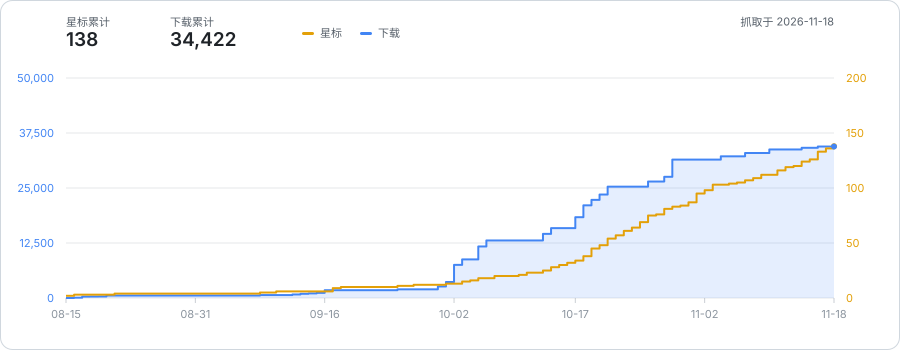

# DeepSeek Harness for Android

[简体中文](README.md) · [繁體中文](README.zh-TW.md) · [한국어](README.ko.md) · [日本語](README.ja.md)

[](https://github.com/dphmoblie/deepseek-harness-android/releases)
[](https://github.com/dphmoblie/deepseek-harness-android/releases)
[](LICENSE)
[](https://github.com/dphmoblie/deepseek-harness-android/commits)
[](https://github.com/dphmoblie/deepseek-harness-android/pulls)
[](https://developer.android.com/)
[](https://developer.android.com/ndk/guides/abis)
[](https://kotlinlang.org/)
[](#qq-group)

<p align="center"></p>

**A local AI workbench right on your Android phone.** It brings [DeepSeek Harness](https://github.com/deepseek-ai/dsh), an Ubuntu runtime, chat sessions, plugins, and file management into a single Android app. When you opt in and grant permissions, the AI can also run device shell tasks via Shizuku or assist with selected apps through Android's accessibility service.

No root access required. Ubuntu runs in userspace via [PRoot](https://github.com/proot-me/proot) on standard Android devices, the web console renders inside a bundled WebView, and model inference connects to whichever API provider or DeepSeek account you configure.

| | |
| --- | --- |
| Package name | `io.deepseekharness.mobile` |
| Minimum Android | Android 8.0 (API 26) or later |
| Target-app virtual display | Android 10 (API 29) or later, requires Shizuku |
| Architecture | `arm64-v8a` only (64-bit ARM) |
| Bundled runtime | Ubuntu 24.04 ARM64 · Node.js 24.19 · `@deepseek-ai/dsh` 0.2.2-rc.5 |
| License | MIT (bundled runtime components keep their own licenses; see [License](#license)) |

## Contents

- [Features](#features)
- [How It Works](#how-it-works)
- [Installation and First-Time Setup](#installation-and-first-time-setup)
- [Model Providers](#model-providers)
- [Optional Shizuku and Automation](#optional-shizuku-and-automation)
- [Target-App Virtual Display (Experimental)](#target-app-virtual-display-experimental)
- [Building from Source](#building-from-source)
- [Security and Privacy](#security-and-privacy)
- [Contributing](#contributing)
- [Project Stats](#project-stats)
- [License](#license)
- [Related Documentation](#related-documentation)

## Features

### Local Runtime and Mobile Experience

- **Full Linux environment without root**: Runs Ubuntu 24.04 locally on your phone via PRoot—no cloud servers, remote desktop, or mandatory app account needed.
- **Ready out of the box, offline-capable**: Official APKs ship with a verified `rootfs.bundle`, so setup finishes completely offline. SHA-256-verified remote runtime sources with resumable downloads and version switching are also supported.
- **Designed for mobile screens**: Organized around three bottom tabs—Home, Plugins, and Settings—with layouts adapted for narrow screens, landscape orientation, and display cutouts, and session management built into Home.
- **Built-in terminals and external browser mode**: Open both the Ubuntu terminal and an optional Shizuku device shell right in the app, or launch the full Harness console in an external browser such as Chrome from the Diagnostics screen.
- **Auto-saved settings and optional prewarm**: General settings save automatically when you leave the screen. You can optionally enable service prewarming on app launch (off by default) so tapping **Open chat** feels nearly instant without switching pages for you.
- **Custom themes and backgrounds**: Choose an image or video background, tweak card color, transparency, blur, and accent colors, and sync your theme and background directly to the DSH console.

### Models, Plugins, and Files

- **Multiple providers plus DeepSeek login**: Built-in support for DeepSeek, OpenAI, Anthropic, Google Gemini, OpenRouter, Groq, xAI, and Mistral, alongside any OpenAI-compatible custom endpoint and official DeepSeek account sign-in.
- **Flexible plugin management**: Install plugins from npm package names, HTTPS archives, or `git+https` repositories, toggle packages and sub-plugins individually, preserve data across updates, and roll back to the previous version. See [Plugin Management](docs/design/插件管理.md) for limitations on native compilation and install scripts.
- **Unified file management and sharing**: Browse the built-in transfer folders (`inbox` / `outbox`) and user-selected shared directories from one screen, create folders, import/export workspace archives, and share or open workspace files with other Android apps.
- **Encrypted backups**: Back up and restore sessions, settings, model credentials, skills, and attachments, encrypted per file with Android Keystore in production builds.

### Background Experience and Diagnostics

- **Optional floating shortcut and background keep-alive**: A foreground service improves background survival (though Android's memory, battery, and OEM policies still apply). The floating shortcut docks cleanly as a thin edge bar by default—tap to open quick actions, or long-press for a draggable AI chat window. Background notifications automatically collapse into a tidy group summary.
- **17-point in-app self-check with one-tap repair**: Diagnose runtime issues without touching bash. Checks cover bash, Node.js, the Landlock sandbox, PTY terminals, writable guest directories, ripgrep, C/Make/Python build tools, and device checks (plugin links, accessibility, overlay permission, and system WebView). Missing execute bits or directories can be repaired in place, with a low-storage warning below 512 MB.
- **Readable logs with actionable hints**: Inspect diagnostic and runtime logs in-app with keyword filtering and level highlighting. Common failures (missing credentials, port conflicts, plugin load errors, etc.) show clear explanations and next steps.

## How It Works

The app is built in three layers:

1. **Management UI (Capacitor + React)**: Handles runtime installation and versioning, service lifecycle, model settings, built-in terminals, and file management.
2. **Native runtime layer (Kotlin)**: Verifies and extracts the rootfs archive, manages the PRoot runner, supervises Harness and PTY processes, enforces permission and command approvals, and connects to Shizuku when authorized.
3. **Ubuntu runtime (PRoot)**: Launches `dsh web` inside Ubuntu 24.04 via a fixed allowlisted entry point, bound strictly to `127.0.0.1`. A Node.js preload script verifies a fresh per-launch access token on every request, and the bundled WebView stays confined to the same loopback origin.

For full architectural and security details, see [docs/ARCHITECTURE.md](docs/ARCHITECTURE.md).

## Installation and First-Time Setup

1. Download the latest APK from the [Releases](https://github.com/dphmoblie/deepseek-harness-android/releases) page and review its release notes.
2. Install the APK (allow installation from trusted sources when prompted by Android).
3. Open the app and follow the 3-step onboarding flow: **Free & Open-Source Notice → Model Setup → Runtime Setup**:
   - **Notice**: This app is completely free and open source, distributed exclusively through GitHub Releases. There is no paid edition or paid installation service.
   - **Model Setup**: Paste your DeepSeek API key and save it. The field stays unmasked during initial setup so you can verify your paste, and automatically strips stray whitespace, `Bearer ` prefixes, and quotes.
   - **Runtime Setup**: Official APKs include the runtime bundle—just tap **Install runtime** and wait for it to finish offline. Self-built APKs without a bundled image can download and switch to a runtime online via **Version Management**.
4. Once setup is complete, return to the Home screen and tap **Open chat** to start.

You can adjust providers later under **Settings → Models & Keys**, and manage runtime versions under **Settings → Ubuntu Runtime / Version Management**. See the [First-Time Setup Guide](docs/operations/首次配置.md) for troubleshooting tips.

### Requirements

- Android 8.0 or later on an **arm64-v8a** (64-bit ARM) device.
- Several GB of free storage for the extracted Ubuntu environment and session data.
- An API key for at least one supported provider, a DeepSeek account, or a compatible custom endpoint.
- No internet connection is required to install the runtime from an official APK; self-built APKs without a bundled rootfs require network access for the initial download.

## Model Providers

- **Built-in providers**: DeepSeek, OpenAI, Anthropic, Google Gemini, OpenRouter, Groq, xAI, and Mistral.
- **Custom providers**: Add any OpenAI-compatible endpoint with its own base URL, API key, and model list.
- **Fetch model lists**: Tap **Fetch models** to pull available models directly from the provider and populate a default choice while preserving any custom model parameters you already configured.

API keys are encrypted at rest via Android Keystore and written to Harness's private `~/.dsh/.credentials.yaml` (`0600`) at runtime—they are never exposed back to the WebView. Saving changes automatically restarts Harness if it is currently running.

### DeepSeek Account Sign-In

Tapping **Sign in with DeepSeek** under **Settings → Models & Keys** opens Harness so you can sign in through the sidebar **More** menu. Returning to Settings refreshes your login status without discarding unsaved API key drafts; account sign-in and API keys work independently.

Only the official `https://platform.deepseek.com/dsh/authorize` URL is handed off to the system browser, and only `/oauth/callback` is permitted for login completion. The app never reads or forwards your account tokens.

## Optional Shizuku and Automation

Shizuku is completely optional and is never bundled with the app:

1. Install and start [Shizuku](https://shizuku.rikka.app/) by following its official instructions (for example, via Wireless Debugging).
2. Grant Shizuku permission inside the app. Whenever Shizuku is running and authorized, the app reconnects automatically; you can also tap **Connect Shizuku** manually.
3. Under **Settings → Shizuku & Device Automation**, enable **Allow AI to invoke Shell** if desired. Once enabled, it stays active until you turn it off.

With Shell enabled, the AI can read or write authorized files and inspect app processes and activity states using Shizuku's standard Android shell privileges—**not root**. If you separately enable the advanced root channel on a rooted device, high-risk actions are gated by tiered approvals and native confirmation dialogs, alongside dedicated guardrails for sensitive files and commands. Command text and output are never written to diagnostic logs; even so, avoid letting the AI read sensitive data such as SMS messages, contacts, passwords, or tokens.

- **Accessibility automation**: Enable the accessibility service manually in Android Settings, then add permitted apps to your allowlist in the app. System settings, permission prompts, payment screens, verification codes, and password fields are always blocked natively, and the service cannot bypass the lock screen.
- **Failure isolation**: If Shizuku is stopped, unauthorized, or disconnected, only device tools report an error—the Ubuntu runtime and normal chat keep working unaffected.
- **Timeout after updating Shizuku**: After upgrading the Shizuku app, the previous background service may still be running and cause connection timeouts. Restart the Shizuku service (or reboot your phone) and try again. Also note that app versions 0.3.5 and earlier had a compatibility issue with Shizuku 13.6.0, which is fixed in **0.3.6 and later**.

## Target-App Virtual Display (Experimental)

Select an app under **Settings → AI Shell → Target-App Virtual Display (Experimental)** to run it on an isolated virtual display and interact with it through the in-app preview or a draggable mini window (separate from the AI chat floating window).

- **Requirements**: Android 10 or later, authorized and connected Shizuku, and AI Shell enabled. Reading and input automatically pause when the screen is locked or off.
- **Capabilities**: Live status and performance metrics, PNG frame capture, virtual-display accessibility tree inspection with screenshot-free UI diffing, tap/swipe/back gestures, CJK/Unicode text input (via accessibility with clipboard fallback), selectable frame-rate tiers (15/30/60 fps and higher), and session teardown. Frames are captured individually rather than video-streamed.
- **Current limitations**: This feature is still experimental, and behavior varies across devices, Android versions, and third-party apps. After updating the APK, existing runtimes must update or repackage the `dsh-mobile-shizuku` plugin to receive new tools. See the [Virtual Display Guide](docs/design/目标应用副屏.md) for architecture details and real-device test records.

## Building from Source

### Prerequisites

- Node.js `^22.19.0` or `>=24.0.0`, and [pnpm](https://pnpm.io/) 11
- Android SDK 35, NDK, CMake 3.22.1, JDK 21, Gradle 8.11.1
- Pinned ARM64 PRoot runner and loader binaries from the Operit2 toolchain (`libdsh_proot.so`, `libdsh_proot_loader.so`)—see [THIRD_PARTY_NOTICES.md](THIRD_PARTY_NOTICES.md) for exact versions and hashes
- For offline self-contained APKs: `runtime-manifest.json` and `rootfs.bundle` built from the same commit

### Web and Android Builds

```bash
pnpm install --frozen-lockfile
pnpm run build          # TypeScript check + Vite production build
pnpm run android:sync   # Build and sync web assets into the Android project
pnpm run android:open   # Open in Android Studio, or build directly with Gradle
```

For development builds without a bundled runtime, set both `DSH_RUNTIME_MANIFEST_URL` and `DSH_RUNTIME_MANIFEST_SHA256` to pin a remote manifest. See [docs/android.md](docs/android.md) for complete build and signing instructions.

### Checks and Tests

```bash
pnpm test          # Vitest unit tests
pnpm --dir scripts/runtime-profile install --frozen-lockfile --ignore-scripts  # Install plugin test dependencies
pnpm run test:scripts
pnpm lint          # ESLint (zero warnings allowed)
```

## Security and Privacy

- **Clear data boundaries**: Running the console locally does not mean the AI model runs offline. Conversations, files read by AI tools, and screenshots may be sent to your configured model provider; simply viewing the local virtual-display preview does not upload images. Grant only the permissions and data each task needs.
- **Loopback-only binding**: Harness binds exclusively to `127.0.0.1`, and the bundled WebView blocks navigation and HTTP resources outside the loopback origin.
- **Per-launch ephemeral tokens**: Every launch generates a fresh 256-bit token via `SecureRandom` to authenticate HTTP and WebSocket traffic. It stays in memory only—never saved to disk, logged, placed in URLs, or exposed to JavaScript.
- **Encrypted credential isolation**: API keys are protected with Android Keystore and supplied to Harness only through `0600` private files, never returned to the WebView.
- **Verified runtime supply chain**: Manifests and rootfs archives undergo schema validation and SHA-256 pinning. Downloads enforce HTTPS, block DNS resolution to private IP ranges, guard archive extraction against path traversal and device nodes, and abort cleanly on malformed range responses.
- **Privacy-preserving audit logs**: Native audit logs are stored in a private, backup-excluded directory, rotated daily (UTC) for 90 days, and record only fixed event/result codes—never URLs, command bodies, tokens, or terminal output.
- **No app accounts, no ads, no telemetry**: The app requires no proprietary account, shows no ads, and collects no analytics.

## Contributing

Issues and pull requests are welcome at <https://github.com/dphmoblie/deepseek-harness-android>.

Please keep pull requests focused, add tests for new behavior, and verify that `pnpm lint` and `pnpm test` pass before submitting. Security-sensitive changes must preserve the boundaries defined in [docs/ARCHITECTURE.md](docs/ARCHITECTURE.md)—in particular loopback isolation, hash verification, entry-point allowlists, and the Shizuku UserService contract.

### Contributors

[](https://github.com/dphmoblie/deepseek-harness-android/graphs/contributors)

More contributors are always welcome—we'd love to see your name here too.

<a id="qq-group"></a><a id="community-qq-group"></a>
### Community

- **QQ Group: 1108895375** — Ask questions, share feedback, and get release updates.

## Project Stats



The yellow line tracks cumulative GitHub stars over time, while the blue line shows cumulative release asset downloads grouped by each release's publish date. The chart refreshes daily via the `stats-chart` workflow and can also be regenerated locally with `pnpm run chart:stats`.

## License

The application source code in this repository is licensed under the [MIT License](LICENSE).

Official release APKs also redistribute third-party runtime components under their respective licenses, including PRoot (GPL-2.0-or-later), the Operit2 runtime toolchain (AGPL-3.0), Ubuntu 24.04 packages, Node.js, and the MIT-licensed DeepSeek Harness runtime and frontend. Full component origins, pinned versions, artifact hashes, and license texts are documented in [THIRD_PARTY_NOTICES.md](THIRD_PARTY_NOTICES.md) and bundled inside the APK under `assets/legal/`.

## Related Documentation

- [First-Time Setup Guide](docs/operations/首次配置.md)
- [Target-App Virtual Display & Testing Scope](docs/design/目标应用副屏.md)
- [App Inspection & Accessibility Automation](docs/design/应用自动化能力.md)
- [Plugin Import, Data Retention & Rollback](docs/design/插件管理.md)
- [File Transfer & Storage Permissions](docs/design/存储权限与导入落点.md)
- [Architecture & Security Boundaries](docs/ARCHITECTURE.md)
- [Mobile Plugin Compatibility](docs/mobile-plugin-compat.md)
- [Project Status & On-Device Verification](docs/项目状态.md)
- [Release Checklist](docs/RELEASE_CHECKLIST.md)
- [Android Build Guide](docs/android.md)
- [Third-Party Notices](THIRD_PARTY_NOTICES.md)
