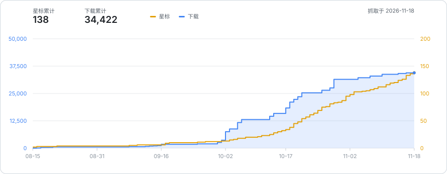

# DeepSeek Harness Android 版

[English](README.en.md) · [简体中文](README.md) · [繁體中文](README.zh-TW.md) · [한국어](README.ko.md)

[](https://github.com/dphmoblie/deepseek-harness-android/releases)
[](https://github.com/dphmoblie/deepseek-harness-android/releases)
[](LICENSE)
[](https://github.com/dphmoblie/deepseek-harness-android/commits)
[](https://github.com/dphmoblie/deepseek-harness-android/pulls)
[](https://developer.android.com/)
[](https://developer.android.com/ndk/guides/abis)
[](https://kotlinlang.org/)
[](#qq-group)

<p align="center"></p>

**スマートフォンで動くローカル AI ワークベンチ。** [DeepSeek Harness](https://github.com/deepseek-ai/dsh)、Ubuntu 実行環境、チャットセッション、プラグイン、ファイル管理を 1 つの Android アプリに統合しています。必要に応じて権限を許可すると、Shizuku 経由で端末のコマンドを実行したり、ユーザー補助機能を使って指定アプリを操作したりすることもできます。

Root 権限は不要です。通常の Android 端末上で [PRoot](https://github.com/proot-me/proot) を使って Ubuntu 環境を動作させ、内蔵 WebView でコンソールを表示します。モデルの推論には、設定した API プロバイダーまたは DeepSeek アカウントを使用します。

| 項目 | 内容 |
| --- | --- |
| パッケージ名 | `io.deepseekharness.mobile` |
| 対応 OS | Android 8.0（API 26）以上 |
| 対象アプリ用仮想ディスプレイ | Android 10（API 29）以上（Shizuku 連携が必要） |
| 対応アーキテクチャ | `arm64-v8a`（64 ビット ARM）のみ |
| 同梱ランタイム | Ubuntu 24.04 ARM64 · Node.js 24.19 · `@deepseek-ai/dsh` 0.2.2-rc.5 |
| ライセンス | MIT（同梱ランタイムの各コンポーネントはそれぞれのライセンスに従います。詳細は[ライセンス](#ライセンス)を参照） |

## 目次

- [主な機能](#主な機能)
- [動作の仕組み](#動作の仕組み)
- [インストールと初期設定](#インストールと初期設定)
- [モデルプロバイダー](#モデルプロバイダー)
- [Shizuku 連携と端末自動化（オプション）](#shizuku-連携と端末自動化オプション)
- [対象アプリ用仮想ディスプレイ（実験的機能）](#対象アプリ用仮想ディスプレイ実験的機能)
- [ソースからのビルド](#ソースからのビルド)
- [セキュリティとプライバシー](#セキュリティとプライバシー)
- [コントリビューション](#コントリビューション)
- [プロジェクト指標](#プロジェクト指標)
- [ライセンス](#ライセンス)
- [関連ドキュメント](#関連ドキュメント)

## 主な機能

### ローカル実行とモバイル向け操作性

- **Root 不要で完全な Linux 環境を構築**：PRoot により Ubuntu 24.04 を端末内でローカル実行します。クラウドサーバーやリモートデスクトップ、専用アカウントの登録は不要です。
- **オフラインですぐにセットアップ可能**：公式リリース版 APK には検証済みの `rootfs.bundle` が同梱されており、ネットワークなしで環境を構築できます。SHA-256 検証付きのリモート取得、レジュームダウンロード、バージョン切り替えにも対応しています。
- **スマホ画面に最適化した UI**：画面下部の「ホーム・プラグイン・設定」の 3 タブで機能を整理し、縦長画面・横画面・ノッチ領域に対応。履歴セッション管理もホーム画面に統合しています。
- **内蔵ターミナルと外部ブラウザ連携**：Ubuntu ターミナルと（オプションの）Shizuku 端末ターミナルをアプリ内でそのまま利用可能。診断画面から Chrome などの外部ブラウザで Harness コンソール全体を開くこともできます。
- **設定の自動保存と事前起動（オプション）**：一般設定は画面を離れると自動で保存されます。アプリ起動時にサービスを事前起動するオプション（デフォルト無効）をオンにすると、ページを勝手に切り替えることなく「会話を開く」の応答を高速化できます。
- **テーマと背景のカスタマイズ**：画像や動画を背景に設定でき、カードの色・透明度・ぼかし・アクセントカラーを調整可能。テーマと背景を DSH コンソール側へ同期することもできます。

### モデル・プラグイン・ファイル管理

- **主要プロバイダー対応と DeepSeek ログイン**：DeepSeek、OpenAI、Anthropic、Google Gemini、OpenRouter、Groq、xAI、Mistral に標準対応しているほか、OpenAI 互換のカスタムエンドポイントや DeepSeek 公式アカウントでのログインにも対応しています。
- **柔軟なプラグイン管理**：npm パッケージ名、HTTPS アーカイブ URL、`git+https` リポジトリからプラグインを導入でき、パッケージやサブプラグイン単位でオン／オフを切り替えられます。更新時のデータ引き継ぎや前バージョンへのロールバックにも対応しています（ネイティブビルドが必要なパッケージ等の制限は[プラグイン管理](docs/design/插件管理.md)を参照）。
- **統合ファイル管理と共有**：「ファイル管理」画面から組み込みフォルダ（`inbox` / `outbox`）と任意の共有フォルダを一元管理でき、フォルダ作成、ワークスペースのアーカイブ入出力、他アプリへのファイル共有・起動に対応しています。
- **暗号化バックアップ**：セッション、設定、モデル認証情報、スキル、添付ファイルをバックアップ・復元できます。リリースビルドでは Android Keystore によりファイル単位で暗号化されます。

### バックグラウンド動作と診断ツール

- **フローティングショートカットとバックグラウンド維持（オプション）**：フォアグラウンドサービスによりバックグラウンドでの維持率を高められます（ただしメモリ不足や省電力設定、端末メーカー独自の制限による終了は完全には防げません）。フローティングボタンはデフォルトで画面端に細いバーとして収まり、タップでメニュー表示、長押しでドラッグ可能な AI チャット小窓を開けます。バックグラウンド通知もグループ化されてすっきり表示されます。
- **17 項目のアプリ内自己診断とワンタップ修復**：コマンドを打たずにランタイムの状態をチェックできます。bash、Node.js、Landlock サンドボックス、PTY、書き込み権限、ripgrep、C / Make / Python のビルドツール、さらに端末側のプラグインリンク・ユーザー補助・オーバーレイ権限・WebView まで一括診断し、権限ビットやディレクトリ欠損はその場で修復可能。空き容量が 512 MB 未満のときは警告を表示します。
- **わかりやすいログ表示と原因ガイド**：診断ログと実行ログをアプリ内で閲覧でき、キーワード検索やレベル別の色分けに対応。認証情報の未設定、ポート競合、プラグイン読み込み失敗などの代表的なトラブルでは、原因と次の対処手順を表示します。

## 動作の仕組み

アプリは以下の 3 層で構成されています。

1. **管理 UI（Capacitor + React）**：ランタイムのインストールとバージョン管理、サービス制御、モデル設定、内蔵ターミナル、ファイル管理を担当します。
2. **ネイティブ制御層（Kotlin）**：イメージの検証と展開、PRoot ランナーの管理、Harness や PTY プロセスの監視、権限・高リスク操作の確認、および認可後の Shizuku 接続を担当します。
3. **Ubuntu ランタイム（PRoot）**：Ubuntu 24.04 内で固定エントリから `dsh web` を起動し、ループバックアドレス（`127.0.0.1`）のみを待ち受けます。起動ごとに生成される一時トークンを Node.js プリロードが全リクエストで検証し、内蔵 WebView も同一オリジン内に制限されます。

詳細なアーキテクチャとセキュリティ境界は [docs/ARCHITECTURE.md](docs/ARCHITECTURE.md) を参照してください。

## インストールと初期設定

1. [Releases](https://github.com/dphmoblie/deepseek-harness-android/releases) から最新の APK をダウンロードし、リリースノートを確認します。
2. 端末に APK をインストールします（必要に応じて不明なアプリのインストールを許可してください）。
3. 初回起動後、3 ステップのガイドに沿って設定を進めます（**無料・オープンソースの案内 → モデル設定 → ランタイム導入**）。
   - **無料・オープンソースの案内**：本アプリは完全無料のオープンソースソフトウェアであり、公式配布元は GitHub Releases のみです。有料版や有料代行インストールは存在しません。
   - **モデル設定**：DeepSeek の API キーを貼り付けて保存します。貼り付けミスや入力補完による欠けを防ぐため、初期設定ではキーを平文表示し、余分な空白・`Bearer ` プレフィックス・引用符を自動で除去します。
   - **ランタイム導入**：公式 APK にはランタイムが同梱されているため、「ランタイムをインストール」を押して待つだけでオフライン導入が完了します。イメージ未同梱の自作ビルドでは、バージョン管理画面からオンライン取得・切り替えを行ってください。
4. セットアップが終わったら、ホーム画面に戻って**会話を開く**をタップすれば利用開始できます。

あとから設定を変更したい場合は**設定 → モデルとキー**、ランタイム管理は**設定 → Ubuntu ランタイム / バージョン管理**から行えます。詳しい手順とトラブル解決は[初期設定ガイド](docs/operations/首次配置.md)をご覧ください。

### 動作環境

- Android 8.0 以上、**arm64-v8a**（64 ビット ARM）対応端末
- 展開後の Ubuntu 環境とセッションデータを保存するための数 GB の空きストレージ
- 対応モデルプロバイダーの API キー、DeepSeek 公式アカウント、または互換カスタムエンドポイント
- 公式 APK はオフラインでランタイムを導入可能（イメージ未同梱のビルドは初回のみネットワーク接続が必要）

## モデルプロバイダー

- **標準対応**：DeepSeek、OpenAI、Anthropic、Google Gemini、OpenRouter、Groq、xAI、Mistral
- **カスタム対応**：OpenAI 互換 API であればベース URL・API キー・モデル一覧を自由に追加可能
- **モデル一覧の取得**：「モデルを取得」からプロバイダー側のモデル一覧を読み込み、先頭候補をデフォルトとして自動入力できます。手動編集したカスタムモデルのパラメータやコンテキスト長は上書きされません。

API キーは Android Keystore で暗号化して保存され、実行時は Harness 専用の `~/.dsh/.credentials.yaml`（権限 `0600`）として提供されます。WebView 側へ返されることはありません。サービス起動中に設定を保存すると、変更を反映するために Harness が自動で再起動します。

### DeepSeek アカウントでログイン

**設定 → モデルとキー**から「DeepSeek アカウントでログイン」を選ぶと Harness が開くので、サイドバーの「その他」メニューから公式ログインを完了してください。設定画面に戻るとログイン状態が自動更新され、未保存の API キー入力も保持されます。アカウントログインと API キーは独立して利用できます。

システムブラウザへの遷移は公式の `https://platform.deepseek.com/dsh/authorize` のみ、コールバックは `/oauth/callback` のみを許可しており、アプリ側がアカウントトークンを読み取ったり転送したりすることはありません。

## Shizuku 連携と端末自動化（オプション）

Shizuku 連携は完全なオプション機能であり、アプリには同梱されません。

1. [Shizuku](https://shizuku.rikka.app/) の公式手順に従ってインストール・起動します（ワイヤレスデバッグ等）。
2. アプリ内で Shizuku の権限を許可します。Shizuku が稼働中で権限が有効であれば自動で再接続され、失敗した場合は**Shizuku に接続**から再試行できます。
3. **設定 → Shizuku とデバイス自動化**で接続を確認後、必要に応じて「AI による Shell 実行を許可」をオンにします。オフにするまで有効状態が続きます。

有効化すると、AI は Shizuku の標準 Android Shell 権限を使ってファイルの読み書きやアプリ状態の照会を行えます。**Shizuku が提供するのは通常の Shell 権限であり、Root 権限ではありません。** Root 化済み端末で高度な Root チャネルを別途有効にした場合も、危険度の高い操作は段階的な承認フローとネイティブ警告画面で保護され、高リスクなファイル・コマンド用の専用ガードレールも用意されています。コマンド内容や出力は診断ログに残りませんが、SMS・連絡先・パスワード・トークンなどの機密情報を AI に読ませないようご注意ください。

- **ユーザー補助による自動化**：Android の設定からサービスを手動で有効にし、アプリ内の許可リストに対象アプリを登録して利用します。システム設定、権限ダイアログ、決済、認証コード、パスワード画面はネイティブ側で強制ブロックされ、ロック画面の解除も行えません。
- **障害の切り離し**：Shizuku が未起動・未認可・切断状態でも、エラーが出るのは端末連携ツールだけで、Ubuntu 環境や通常のチャットには影響しません。
- **Shizuku 更新後に接続タイムアウトする場合**：Shizuku アプリ更新後に旧バックグラウンドサービスが残っているとタイムアウトすることがあります。Shizuku 側でサービスを再起動（または端末を再起動）してからお試しください。なお、本アプリ 0.3.5 以前と Shizuku 13.6.0 の互換性問題は **0.3.6 以降で解消済み**です。

## 対象アプリ用仮想ディスプレイ（実験的機能）

**設定 → AI Shell → 対象アプリ用仮想ディスプレイ（実験的機能）**からアプリを選ぶと、独立した仮想ディスプレイ上で起動し、アプリ内プレビューやドラッグ可能な小窓から表示・操作できます（AI チャット用の小窓とは別の機能です）。

- **利用条件**：Android 10 以上、Shizuku の許可と接続、AI Shell の有効化が必要です。画面ロック中・消灯中は読み取りと入力が自動停止します。
- **主な機能**：状態やフレーム情報の取得、PNG キャプチャ、仮想ディスプレイ専用のユーザー補助ツリー取得とスクリーンショット不要の画面差分検出、タップ／スワイプ／戻る操作、日本語・中国語などのテキスト入力（ユーザー補助経由・クリップボード併用）、フレームレート設定（15/30/60 fps など）、セッション終了。映像は動画ストリームではなくフレーム単位の取得です。
- **制限事項**：現在も実験段階であり、端末・OS バージョン・対象アプリによって挙動が異なります。APK 更新後、既存ランタイムで新ツールを使うには `dsh-mobile-shizuku` プラグインの更新または再パッケージが必要です。詳しい仕組みと実機検証の記録は[対象アプリ用仮想ディスプレイの説明](docs/design/目标应用副屏.md)を参照してください。

## ソースからのビルド

### 必要なツール

- Node.js `^22.19.0` または `>=24.0.0`、[pnpm](https://pnpm.io/) 11
- Android SDK 35、NDK、CMake 3.22.1、JDK 21、Gradle 8.11.1
- Operit2 ツールチェーン由来の ARM64 PRoot ランナーおよびローダー（`libdsh_proot.so`、`libdsh_proot_loader.so`）——正確なバージョンとハッシュは [THIRD_PARTY_NOTICES.md](THIRD_PARTY_NOTICES.md) を参照
- オフライン完結版 APK をビルドする場合は、同一ソースから生成した `runtime-manifest.json` と `rootfs.bundle`

### Web と Android のビルド

```bash
pnpm install --frozen-lockfile
pnpm run build          # TypeScript 型チェック + Vite 本番ビルド
pnpm run android:sync   # フロントエンド成果物を Android プロジェクトへ同期
pnpm run android:open   # Android Studio で開く（または Gradle で直接ビルド）
```

開発ビルドではランタイムを同梱せず、`DSH_RUNTIME_MANIFEST_URL` と `DSH_RUNTIME_MANIFEST_SHA256` を設定してリモートマニフェストを指定できます。詳細な手順と署名設定は [docs/android.md](docs/android.md) を参照してください。

### テストと静的解析

```bash
pnpm test          # Vitest 単体テスト
pnpm --dir scripts/runtime-profile install --frozen-lockfile --ignore-scripts  # プラグインテスト用依存パッケージの導入
pnpm run test:scripts
pnpm lint          # ESLint（警告ゼロ必須）
```

## セキュリティとプライバシー

- **データ送信の透明性**：コンソールを端末内で動かしていても、推論モデル自体はオフラインではありません。会話内容、AI ツールが読み込んだファイル、スクリーンショットは設定したモデルサービスへ送信される場合があります（仮想ディスプレイのローカルプレビュー自体は画像を送信しません）。作業に必要な最小限の権限のみ許可してください。
- **ループバック限定**：Harness は `127.0.0.1` のみにバインドし、内蔵 WebView はループバックオリジン外への遷移やリソース読み込みを遮断します。
- **起動ごとの一時トークン**：起動のたびに `SecureRandom` で 256 ビットのトークンを生成し、HTTP と WebSocket の全通信を検証します。メモリ上のみに保持し、保存・ログ出力・URL 埋め込み・JavaScript への公開は行いません。
- **認証情報の保護**：API キーは Android Keystore で暗号化され、実行時も `0600` 権限の専用ファイル経由でのみ Harness へ渡されます。
- **検証済みランタイム配布**：マニフェストと rootfs はスキーマ検証と SHA-256 で固定されています。HTTPS ダウンロード強制、プライベート IP への DNS 解決拒否、展開時のパストラバーサル・デバイスノード対策を備え、異常時は中途半端なファイルを使わずに安全に中止します。
- **プライバシー配慮の監査ログ**：ネイティブ監査ログはバックアップ除外のアプリ専用領域に保存され、UTC 日次ローテーションで 90 日間保持されます。記録されるのは固定イベントと結果コードのみで、URL・コマンド・トークン・端末出力は一切含みません。
- **アカウント不要・広告なし・トラッキングなし**：アプリ独自のアカウント登録、広告表示、テレメトリ収集は一切ありません。

## コントリビューション

<https://github.com/dphmoblie/deepseek-harness-android> への Issue や Pull Request を歓迎します。

PR 作成時は変更範囲を絞り、新しい挙動に対するテストを追加したうえで、`pnpm lint` と `pnpm test` が通ることを確認してください。セキュリティに関わる変更は [docs/ARCHITECTURE.md](docs/ARCHITECTURE.md) の設計境界（ループバック隔離、ハッシュ検証、エントリ許可リスト、Shizuku UserService 契約など）を維持する必要があります。

### コントリビューター

[](https://github.com/dphmoblie/deepseek-harness-android/graphs/contributors)

開発へのご参加をお待ちしています。

<a id="qq-group"></a><a id="community-qq-group"></a>
### コミュニティ

- **QQ グループ：1108895375** —— 質問、フィードバック、リリース通知の受け取りにご参加ください。

## プロジェクト指標



黄色の線は GitHub スター数の累計推移、青色の線は全リリース資産の累計ダウンロード数（リリース日ごとに集計）を示しています。グラフは `stats-chart` ワークフローで毎日自動更新され、ローカルでも `pnpm run chart:stats` で再生成できます。

## ライセンス

本リポジトリのアプリケーションコードは [MIT ライセンス](LICENSE)の下で公開されています。

公式リリース版 APK には、PRoot（GPL-2.0-or-later）、Operit2 ランタイムツールチェーン（AGPL-3.0）、Ubuntu 24.04 パッケージ、Node.js、および MIT ライセンスの DeepSeek Harness ランタイム／フロントエンドなど、サードパーティコンポーネントがそれぞれのライセンスに従って同梱されています。各コンポーネントの由来、正確なバージョン、ハッシュ値、ライセンス全文は [THIRD_PARTY_NOTICES.md](THIRD_PARTY_NOTICES.md) および APK 内の `assets/legal/` に収録されています。

## 関連ドキュメント

- [初期設定ガイド（3 ステップで開始）](docs/operations/首次配置.md)
- [対象アプリ用仮想ディスプレイと検証状況](docs/design/目标应用副屏.md)
- [アプリ情報の読み取りとユーザー補助自動化](docs/design/应用自动化能力.md)
- [プラグインの導入・データ引き継ぎ・ロールバック](docs/design/插件管理.md)
- [ファイル共有とストレージ権限](docs/design/存储权限与导入落点.md)
- [アーキテクチャとセキュリティ境界](docs/ARCHITECTURE.md)
- [モバイル向けプラグイン互換設計](docs/mobile-plugin-compat.md)
- [プロジェクト状況と実機テスト記録](docs/项目状态.md)
- [リリースチェックリスト](docs/RELEASE_CHECKLIST.md)
- [Android ビルド手順](docs/android.md)
- [サードパーティライセンス情報](THIRD_PARTY_NOTICES.md)
