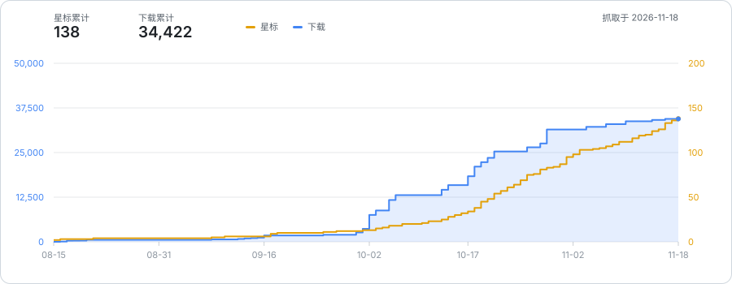

# DeepSeek Harness Android

[English](README.en.md) · [简体中文](README.md) · [繁體中文](README.zh-TW.md) · [日本語](README.ja.md)

[](https://github.com/dphmoblie/deepseek-harness-android/releases)
[](https://github.com/dphmoblie/deepseek-harness-android/releases)
[](LICENSE)
[](https://github.com/dphmoblie/deepseek-harness-android/commits)
[](https://github.com/dphmoblie/deepseek-harness-android/pulls)
[](https://developer.android.com/)
[](https://developer.android.com/ndk/guides/abis)
[](https://kotlinlang.org/)
[](#qq-group)

<p align="center"></p>

**스마트폰에서 바로 쓰는 로컬 AI 워크벤치입니다.** [DeepSeek Harness](https://github.com/deepseek-ai/dsh), Ubuntu 실행 환경, 채팅 세션, 플러그인, 파일 관리를 하나의 Android 앱에 담았습니다. 원할 경우 권한을 허용해 Shizuku로 기기 셸 작업을 실행하거나, 접근성 서비스로 지정한 앱을 조작할 수도 있습니다.

루팅은 필요하지 않습니다. 일반 Android 기기에서 [PRoot](https://github.com/proot-me/proot)로 Ubuntu 환경을 로컬 실행하고, 내장 WebView로 콘솔을 표시합니다. 모델 추론에는 직접 설정한 API 공급자나 DeepSeek 계정을 사용합니다.

| 항목 | 내용 |
| --- | --- |
| 패키지 이름 | `io.deepseekharness.mobile` |
| 지원 OS | Android 8.0(API 26) 이상 |
| 대상 앱 가상 화면 | Android 10(API 29) 이상(Shizuku 연동 필요) |
| 지원 아키텍처 | `arm64-v8a`(64비트 ARM) 전용 |
| 내장 런타임 | Ubuntu 24.04 ARM64 · Node.js 24.19 · `@deepseek-ai/dsh` 0.2.2-rc.5 |
| 라이선스 | MIT(내장 런타임 구성 요소는 각 라이선스를 따르며, 자세한 내용은 [라이선스](#라이선스) 참조) |

## 목차

- [주요 기능](#주요-기능)
- [동작 원리](#동작-원리)
- [설치 및 초기 설정](#설치-및-초기-설정)
- [모델 공급자](#모델-공급자)
- [Shizuku 연동 및 기기 자동화(선택 사항)](#shizuku-연동-및-기기-자동화선택-사항)
- [대상 앱 가상 화면(실험 기능)](#대상-앱-가상-화면실험-기능)
- [소스에서 빌드하기](#소스에서-빌드하기)
- [보안 및 개인정보](#보안-및-개인정보)
- [기여하기](#기여하기)
- [프로젝트 지표](#프로젝트-지표)
- [라이선스](#라이선스)
- [관련 문서](#관련-문서)

## 주요 기능

### 로컬 실행과 모바일 최적화

- **루팅 없이 실행하는 완전한 Linux 환경**: PRoot를 통해 기기 안에서 직접 Ubuntu 24.04를 실행합니다. 클라우드 서버나 원격 데스크톱, 별도의 앱 계정 가입이 필요하지 않습니다.
- **설치 즉시 사용 가능한 오프라인 지원**: 공식 배포 APK에는 무결성 검증을 마친 `rootfs.bundle`이 포함되어 있어 인터넷 없이도 런타임을 설치할 수 있습니다. SHA-256 검증이 적용된 원격 소스, 이어받기, 버전 전환도 지원합니다.
- **모바일 화면에 맞춘 인터페이스**: 하단 탭(홈 · 플러그인 · 설정) 중심으로 기능을 정리하고, 좁은 화면·가로 모드·노치 안전 영역에 맞춰 레이아웃을 최적화했습니다. 대화 세션 관리도 홈 화면에 통합되어 있습니다.
- **내장 터미널 및 외부 브라우저 지원**: 앱 안에서 Ubuntu 터미널과 (선택적) Shizuku 기기 터미널을 바로 사용할 수 있으며, 진단 화면에서 Chrome 같은 외부 브라우저로 전체 Harness 콘솔을 열어 사용할 수도 있습니다.
- **설정 자동 저장 및 선택적 사전 시작**: 일반 설정은 화면을 벗어나면 자동으로 저장됩니다. 앱 실행 시 로컬 서비스를 미리 켜 두는 옵션(기본값 꺼짐)을 켜면 화면을 임의로 전환하지 않고도 **대화 열기** 응답 속도를 높일 수 있습니다.
- **테마 및 배경 커스터마이징**: 이미지·동영상 배경을 지정하고 카드 색상, 투명도, 블러, 강조 색상을 조절할 수 있으며, 테마와 배경을 DSH 콘솔에도 그대로 동기화할 수 있습니다.

### 모델, 플러그인 및 파일 관리

- **주요 모델 공급자와 DeepSeek 로그인**: DeepSeek, OpenAI, Anthropic, Google Gemini, OpenRouter, Groq, xAI, Mistral을 기본 지원하며, OpenAI 호환 사용자 지정 엔드포인트와 DeepSeek 공식 계정 로그인도 사용할 수 있습니다.
- **유연한 플러그인 관리**: npm 패키지 이름, HTTPS 압축 파일 URL, `git+https` 저장소에서 플러그인을 설치하고 패키지 및 하위 플러그인을 개별 제어할 수 있습니다. 업데이트 시 데이터를 보존하며 이전 버전으로 롤백할 수 있습니다(네이티브 빌드 등 제약 사항은 [플러그인 관리](docs/design/插件管理.md) 참조).
- **통합 파일 관리 및 공유**: 「파일 관리」 화면에서 기본 폴더(`inbox` / `outbox`)와 사용자가 추가한 공유 디렉터리를 한곳에서 탐색하고, 폴더 생성, 작업 공간 아카이브 가져오기/내보내기, 다른 앱으로 파일 공유·열기를 수행할 수 있습니다.
- **암호화 백업 및 복원**: 세션, 설정, 모델 자격 증명, 스킬, 첨부 파일을 백업하고 복원할 수 있으며, 정식 빌드에서는 파일별로 Android Keystore 암호화가 적용됩니다.

### 백그라운드 편의 기능과 자가 진단

- **플로팅 바로가기 및 백그라운드 유지(선택 사항)**: 포그라운드 서비스를 켜면 백그라운드 유지 가능성이 높아집니다(단, 기기 메모리·배터리·제조사 정책에 따른 종료까지 완전히 막을 수는 없습니다). 플로팅 버튼은 기본 상태에서 화면 가장자리에 얇은 막대로 접혀 있으며, 탭하면 빠른 메뉴가 열리고 길게 누르면 드래그 가능한 AI 채팅 미니 창이 나타납니다. 백그라운드 알림도 하나의 그룹으로 깔끔하게 묶여 표시됩니다.
- **17개 항목 앱 내 자가 진단 및 원클릭 복구**: 명령어를 직접 입력하지 않아도 런타임 상태를 점검할 수 있습니다. bash, Node.js, Landlock 샌드박스, PTY 터미널, 디렉터리 쓰기 권한, ripgrep, C / Make / Python 빌드 도구, 그리고 기기 측 플러그인 링크·접근성·오버레이 권한·시스템 WebView까지 확인하며, 실행 권한이나 폴더 누락은 그 자리에서 복구합니다. 여유 공간이 512 MB 미만일 때는 경고를 표시합니다.
- **이해하기 쉬운 로그 및 문제 해결 안내**: 앱 안에서 진단 로그와 실행 로그를 키워드 검색 및 레벨별 색상으로 확인할 수 있으며, 자격 증명 누락·포트 충돌·플러그인 로드 오류 같은 흔한 문제는 원인과 해결 방법을 함께 안내합니다.

## 동작 원리

앱은 다음 세 계층으로 구성됩니다.

1. **관리 UI(Capacitor + React)**: 런타임 설치 및 버전 관리, 서비스 제어, 모델 설정, 내장 터미널, 파일 관리를 담당합니다.
2. **네이티브 제어 계층(Kotlin)**: 이미지 검증 및 압축 해제, PRoot 러너 관리, Harness 및 PTY 프로세스 감시, 권한·고위험 작업 승인, 사용자 허가 후 Shizuku 연결을 담당합니다.
3. **Ubuntu 런타임(PRoot)**: Ubuntu 24.04 내부에서 허용된 고정 진입점으로 `dsh web`을 실행하고 루프백 주소(`127.0.0.1`)만 수신합니다. 시작할 때마다 생성되는 일회성 토큰을 Node.js 프리로드가 모든 요청에서 검증하며, 내장 WebView도 동일 오리진으로 제한됩니다.

전체 아키텍처와 보안 경계는 [docs/ARCHITECTURE.md](docs/ARCHITECTURE.md)를 참조하세요.

## 설치 및 초기 설정

1. [Releases](https://github.com/dphmoblie/deepseek-harness-android/releases) 페이지에서 최신 APK를 다운로드하고 해당 버전의 릴리스 노트를 확인합니다.
2. 기기에 APK를 설치합니다(시스템 안내에 따라 신뢰할 수 있는 출처의 앱 설치 허용).
3. 처음 실행하면 3단계 안내에 따라 초기 설정을 진행합니다(**무료·오픈소스 안내 → 모델 설정 → 런타임 설치**).
   - **무료·오픈소스 안내**: 이 앱은 완전 무료 오픈소스 소프트웨어이며 공식 배포 채널은 GitHub Releases뿐입니다. 유료 버전이나 유료 설치 대행은 존재하지 않습니다.
   - **모델 설정**: DeepSeek API 키를 붙여 넣고 저장합니다. 붙여넣기 누락이나 입력기 오작동을 눈으로 확인할 수 있도록 초기 설정에서는 키를 가리지 않고 표시하며, 불필요한 공백·`Bearer ` 접두사·따옴표를 자동으로 정리합니다.
   - **런타임 설치**: 공식 APK에는 런타임 이미지가 포함되어 있어 **런타임 설치**만 누르면 오프라인으로 완료됩니다. 이미지가 포함되지 않은 직접 빌드 APK라면 버전 관리 화면에서 온라인으로 다운로드한 뒤 전환하세요.
4. 설정을 마친 뒤 홈 화면으로 돌아와 **대화 열기**를 누르면 바로 시작할 수 있습니다.

이후에는 **설정 → 모델 및 키**에서 공급자를 변경하고, **설정 → Ubuntu 런타임 / 버전 관리**에서 런타임을 관리할 수 있습니다. 자세한 단계와 문제 해결 방법은 [초기 설정 가이드](docs/operations/首次配置.md)를 참고하세요.

### 요구 사항

- Android 8.0 이상, **arm64-v8a**(64비트 ARM) 프로세서 기기
- 압축 해제된 Ubuntu 환경과 세션 데이터를 저장할 수 GB 단위의 여유 공간
- 지원 모델 공급자의 API 키, DeepSeek 공식 계정, 또는 호환 가능한 사용자 지정 엔드포인트
- 공식 APK는 오프라인으로 런타임 설치 가능(이미지 미포함 빌드는 최초 다운로드 시 인터넷 필요)

## 모델 공급자

- **기본 지원**: DeepSeek, OpenAI, Anthropic, Google Gemini, OpenRouter, Groq, xAI, Mistral
- **사용자 지정 공급자**: OpenAI 호환 API라면 기본 URL, API 키, 모델 목록을 자유롭게 추가할 수 있습니다.
- **모델 목록 불러오기**: **모델 가져오기**를 누르면 공급자에서 사용 가능한 모델 목록을 불러와 기본 항목을 자동으로 채우며, 이미 직접 수정한 모델 옵션과 컨텍스트 길이는 유지합니다.

API 키는 Android Keystore로 암호화되어 저장되며 실행 시 Harness 전용 `~/.dsh/.credentials.yaml`(`0600` 권한)로 전달됩니다. WebView로 반환되는 일은 없습니다. 실행 중에 설정을 저장하면 변경 사항을 즉시 반영하기 위해 Harness가 자동으로 재시작됩니다.

### DeepSeek 계정 로그인

**설정 → 모델 및 키**에서 **DeepSeek 계정 로그인**을 누르면 Harness가 열리며, 사이드바의 **더 보기** 메뉴에서 공식 로그인을 진행할 수 있습니다. 완료 후 설정 화면으로 돌아오면 로그인 상태가 자동 갱신되고 저장 전 API 키 초안도 유지됩니다. 계정 로그인과 API 키는 서로 독립적으로 동작합니다.

시스템 브라우저 이동은 공식 `https://platform.deepseek.com/dsh/authorize` 주소만, 콜백은 `/oauth/callback`만 허용하며 앱이 계정 토큰을 읽거나 전달하지 않습니다.

## Shizuku 연동 및 기기 자동화(선택 사항)

Shizuku는 완전히 선택 사항이며 앱에 함께 설치되지 않습니다.

1. [Shizuku](https://shizuku.rikka.app/) 공식 안내에 따라 앱을 설치하고 서비스를 실행합니다(예: 무선 디버깅 활용).
2. 본 앱에서 Shizuku 권한을 허용합니다. Shizuku가 실행 중이고 권한이 유효하면 자동으로 다시 연결되며, 실패 시 **Shizuku 연결** 버튼으로 재시도할 수 있습니다.
3. **설정 → Shizuku 및 기기 자동화**에서 연결을 확인한 뒤 필요하면 **AI의 Shell 호출 허용**을 켭니다. 직접 끌 때까지 유지됩니다.

활성화하면 AI가 Shizuku의 일반 Android Shell 권한으로 파일 입출력이나 앱 상태 조회를 수행할 수 있습니다. **Shizuku는 일반 셸 권한이지 루트 권한이 아닙니다.** 루팅된 기기에서 고급 루트 채널을 별도로 켠 경우에도 위험도가 높은 명령은 단계별 승인 절차와 네이티브 경고 화면으로 보호되며, 민감한 파일·명령을 차단하는 전용 보호 설정도 제공됩니다. 명령 내용과 출력은 진단 로그에 남지 않지만, 문자·연락처·비밀번호·토큰 같은 민감한 정보를 AI에게 읽히지 않도록 주의하세요.

- **접근성 자동화**: Android 설정에서 접근성 서비스를 직접 켠 뒤 앱 안에서 허용할 대상 앱을 목록에 추가해 사용합니다. 시스템 설정, 권한 팝업, 결제, 인증 코드, 비밀번호 화면은 네이티브 계층에서 항상 차단되며 잠금 화면을 우회할 수 없습니다.
- **오류 격리**: Shizuku가 꺼져 있거나 권한이 없어도 기기 연동 도구만 오류를 반환할 뿐 Ubuntu 런타임과 일반 대화는 정상 동작합니다.
- **Shizuku 업데이트 후 연결 시간 초과**: Shizuku 앱 업데이트 직후 이전 백그라운드 서비스가 남아 있으면 연결이 시간 초과될 수 있습니다. Shizuku에서 서비스를 재시작하거나 기기를 재부팅한 뒤 다시 시도하세요. 또한 본 앱 0.3.5 이하 버전과 Shizuku 13.6.0 간 호환성 문제는 **0.3.6 이상에서 해결**되었습니다.

## 대상 앱 가상 화면(실험 기능)

**설정 → AI Shell → 대상 앱 가상 화면(실험 기능)**에서 앱을 선택하면 별도의 가상 디스플레이에서 해당 앱을 실행하고, 앱 내 미리보기나 드래그 가능한 미니 창으로 확인하고 조작할 수 있습니다(AI 채팅 미니 창과는 별도 기능입니다).

- **사용 조건**: Android 10 이상, Shizuku 권한 부여 및 연결 완료, AI Shell 활성화가 필요합니다. 화면이 잠기거나 꺼지면 읽기와 입력이 자동으로 일시 중지됩니다.
- **지원 기능**: 상태 및 성능 지표 조회, PNG 화면 캡처, 가상 디스플레이 전용 접근성 트리 조회 및 스크린샷 없는 UI 변경 감지, 탭·스와이프·뒤로 가기, 다국어 텍스트 입력(접근성 입력 + 클립보드 대체), 15/30/60 fps 등 프레임 레이트 설정, 세션 종료를 지원합니다. 화면은 동영상 스트리밍이 아닌 프레임 단위 캡처 방식입니다.
- **제한 사항**: 아직 실험 단계이므로 기기·OS 버전·대상 앱에 따라 호환성 차이가 있습니다. APK를 업데이트한 뒤 기존 런타임에서 새 도구를 사용하려면 `dsh-mobile-shizuku` 플러그인도 함께 업데이트하거나 다시 패키징해야 합니다. 상세 구조와 실기기 테스트 기록은 [대상 앱 가상 화면 안내](docs/design/目标应用副屏.md)를 참조하세요.

## 소스에서 빌드하기

### 사전 준비

- Node.js `^22.19.0` 또는 `>=24.0.0`, [pnpm](https://pnpm.io/) 11
- Android SDK 35, NDK, CMake 3.22.1, JDK 21, Gradle 8.11.1
- Operit2 툴체인에서 제공하는 고정 버전 ARM64 PRoot 러너 및 로더(`libdsh_proot.so`, `libdsh_proot_loader.so`) — 정확한 업스트림 버전과 해시는 [THIRD_PARTY_NOTICES.md](THIRD_PARTY_NOTICES.md) 참조
- 오프라인 자체 포함 APK 빌드 시 같은 소스에서 생성한 `runtime-manifest.json` 및 `rootfs.bundle`

### Web 및 Android 빌드

```bash
pnpm install --frozen-lockfile
pnpm run build          # TypeScript 타입 검사 + Vite 프로덕션 빌드
pnpm run android:sync   # 웹 산출물을 Android 프로젝트로 동기화
pnpm run android:open   # Android Studio에서 열기(또는 Gradle로 직접 빌드)
```

개발 빌드에서는 런타임을 포함하지 않고 `DSH_RUNTIME_MANIFEST_URL`과 `DSH_RUNTIME_MANIFEST_SHA256`을 설정해 원격 매니페스트를 지정할 수 있습니다. 전체 빌드 및 서명 안내는 [docs/android.md](docs/android.md)를 참고하세요.

### 검사 및 테스트

```bash
pnpm test          # Vitest 단위 테스트
pnpm --dir scripts/runtime-profile install --frozen-lockfile --ignore-scripts  # 플러그인 테스트 의존성 설치
pnpm run test:scripts
pnpm lint          # ESLint 검사(경고 0개 필수)
```

## 보안 및 개인정보

- **데이터 전송 범위**: 콘솔이 기기 안에서 실행된다고 해서 AI 모델까지 오프라인으로 동작하는 것은 아닙니다. 대화 내용, AI 도구가 읽은 파일, 스크린샷은 설정한 모델 서비스로 전송될 수 있습니다(로컬 가상 화면 미리보기 자체는 이미지를 업로드하지 않습니다). 작업에 필요한 최소한의 권한과 데이터만 허용하세요.
- **루프백 전용 바인딩**: Harness는 `127.0.0.1`에만 바인딩되며, 내장 WebView는 루프백 오리진 외부의 페이지 이동과 리소스 요청을 차단합니다.
- **실행마다 새로 발급되는 임시 토큰**: Harness를 시작할 때마다 `SecureRandom`으로 256비트 토큰을 새로 생성해 HTTP와 WebSocket 요청을 모두 보호합니다. 토큰은 메모리에만 머물며 저장·로그 기록·URL 포함·JavaScript 노출을 모두 차단합니다.
- **자격 증명 암호화 격리**: API 키는 Android Keystore로 보호되며 실행 시에도 `0600` 권한의 비공개 파일로만 Harness에 전달됩니다.
- **검증 가능한 런타임 공급망**: 매니페스트와 루트 파일 시스템은 스키마 검증과 SHA-256 고정 검증을 거칩니다. HTTPS 다운로드 강제, 사설 IP DNS 차단, 압축 해제 시 경로 탈출 및 장치 노드 방어를 적용하며 오류 시 불완전한 파일을 사용하지 않고 안전하게 중단합니다.
- **개인정보를 보호하는 감사 로그**: 네이티브 감사 로그는 백업에서 제외된 앱 전용 디렉터리에 저장되며 UTC 기준으로 매일 순환해 90일간 보관됩니다. 고정된 이벤트·결과 코드만 기록하며 URL, 명령 본문, 토큰, 터미널 출력은 절대 포함하지 않습니다.
- **계정·광고·추적 없음**: 자체 회원 가입, 광고, 원격 분석(텔레메트리) 수집이 전혀 없습니다.

## 기여하기

<https://github.com/dphmoblie/deepseek-harness-android> 에서 Issue와 Pull Request를 환영합니다.

PR을 올리기 전에 변경 범위를 명확히 유지하고, 새 기능에 대한 테스트를 추가한 뒤 `pnpm lint`와 `pnpm test` 통과 여부를 확인해 주세요. 보안 관련 변경은 [docs/ARCHITECTURE.md](docs/ARCHITECTURE.md)의 경계(루프백 격리, 해시 검증, 진입점 허용 목록, Shizuku UserService 계약 등)를 반드시 유지해야 합니다.

### 기여자

[](https://github.com/dphmoblie/deepseek-harness-android/graphs/contributors)

많은 개발자분들의 참여를 기다립니다.

<a id="qq-group"></a><a id="community-qq-group"></a>
### 커뮤니티

- **QQ 그룹: 1108895375** — 질문, 피드백 공유, 새 버전 릴리스 소식을 받아 보실 수 있습니다.

## 프로젝트 지표



노란 선은 GitHub 스타 누적 추이, 파란 선은 전체 릴리스 자산의 누적 다운로드 수(릴리스 날짜 기준 집계)를 나타냅니다. 차트는 `stats-chart` 워크플로가 매일 자동으로 갱신하며, 로컬에서 `pnpm run chart:stats`로 직접 다시 생성할 수도 있습니다.

## 라이선스

이 저장소의 애플리케이션 코드는 [MIT 라이선스](LICENSE)로 배포됩니다.

공식 릴리스 APK에는 PRoot(GPL-2.0-or-later), Operit2 런타임 툴체인(AGPL-3.0), Ubuntu 24.04 패키지, Node.js, 그리고 MIT 라이선스의 DeepSeek Harness 런타임 및 프런트엔드 등 서드파티 구성 요소가 각 라이선스에 따라 함께 포함됩니다. 구성 요소 출처, 정확한 업스트림 버전, 해시, 라이선스 전문은 [THIRD_PARTY_NOTICES.md](THIRD_PARTY_NOTICES.md) 및 APK 내 `assets/legal/` 디렉터리에서 확인할 수 있습니다.

## 관련 문서

- [초기 설정 가이드(3단계로 시작하기)](docs/operations/首次配置.md)
- [대상 앱 가상 화면 및 테스트 범위](docs/design/目标应用副屏.md)
- [앱 정보 읽기 및 접근성 자동화](docs/design/应用自动化能力.md)
- [플러그인 설치, 데이터 보존 및 롤백](docs/design/插件管理.md)
- [파일 공유 및 저장소 권한](docs/design/存储权限与导入落点.md)
- [아키텍처 및 보안 경계](docs/ARCHITECTURE.md)
- [모바일 플러그인 호환성 설계](docs/mobile-plugin-compat.md)
- [프로젝트 현황 및 실기기 테스트 기록](docs/项目状态.md)
- [릴리스 체크리스트](docs/RELEASE_CHECKLIST.md)
- [Android 빌드 가이드](docs/android.md)
- [서드파티 라이선스 고지](THIRD_PARTY_NOTICES.md)
