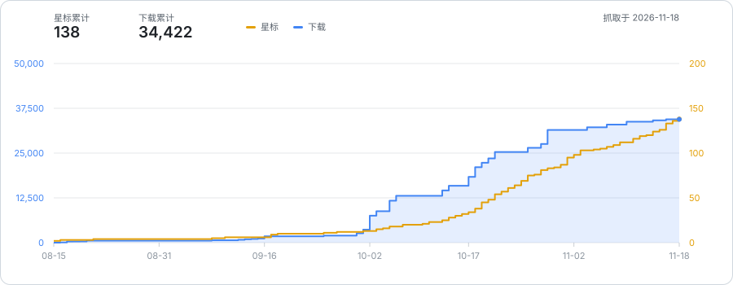

# DeepSeek Harness 安卓版

[English](README.en.md) · [繁體中文](README.zh-TW.md) · [한국어](README.ko.md) · [日本語](README.ja.md)

[](https://github.com/dphmoblie/deepseek-harness-android/releases)
[](https://github.com/dphmoblie/deepseek-harness-android/releases)
[](LICENSE)
[](https://github.com/dphmoblie/deepseek-harness-android/commits)
[](https://github.com/dphmoblie/deepseek-harness-android/pulls)
[](https://developer.android.com/)
[](https://developer.android.com/ndk/guides/abis)
[](https://kotlinlang.org/)
[](#qq-group)

<p align="center"></p>

**装在手机里的本地 AI 工作台。** 它将 [DeepSeek Harness](https://github.com/deepseek-ai/dsh)、Ubuntu 运行环境、对话会话、插件系统与文件管理整合到同一个 Android 应用中。在你主动开启授权后，AI 还可以配合 Shizuku 执行手机端命令行任务，或通过无障碍服务辅助操作指定应用。

无需 Root 权限。Ubuntu 环境通过 [PRoot](https://github.com/proot-me/proot) 直接在普通手机上运行，控制台由内置 WebView 呈现，模型推理则连接你自己配置的模型服务或 DeepSeek 账号。

| 项目 | 说明 |
| --- | --- |
| 应用包名 | `io.deepseekharness.mobile` |
| 系统要求 | Android 8.0（API 26）及以上 |
| 目标应用副屏 | Android 10（API 29）及以上，需配合 Shizuku 使用 |
| CPU 架构 | 仅支持 `arm64-v8a`（64 位 ARM） |
| 内置环境 | Ubuntu 24.04 ARM64 · Node.js 24.19 · `@deepseek-ai/dsh` 0.2.2-rc.5 |
| 开源协议 | MIT（内置运行时组件沿用各自协议，见[许可证](#许可证)） |

## 目录

- [功能特性](#功能特性)
- [工作原理](#工作原理)
- [安装与首次配置](#安装与首次配置)
- [模型供应商](#模型供应商)
- [可选的 Shizuku 与自动化集成](#可选的-shizuku-与自动化集成)
- [目标应用副屏（实验功能）](#目标应用副屏实验功能)
- [从源码构建](#从源码构建)
- [安全与隐私](#安全与隐私)
- [参与贡献](#参与贡献)
- [项目数据](#项目数据)
- [许可证](#许可证)
- [相关文档](#相关文档)

## 功能特性

### 本地运行与移动端体验

- **免 Root 运行完整 Linux 环境**：通过 PRoot 在手机本地运行 Ubuntu 24.04，不需要云服务器或远程桌面，也不强制注册应用账号。
- **开箱即用，支持离线安装**：官方发布版 APK 已内置经过校验的 `rootfs.bundle` 镜像，不联网也能完成环境安装；同时也支持经 SHA-256 校验的远程镜像源，并具备断点续传与版本切换能力。
- **为手机重新梳理的界面**：底部以「首页、插件、设置」三大入口组织功能，适配窄屏、横屏与刘海屏安全区，并将历史会话管理整合到首页。
- **内置终端与外置浏览器**：应用内可直接打开 Ubuntu 终端和（可选）Shizuku 设备终端；也可以在诊断页将完整的 Harness 控制台交给 Chrome 等外置浏览器使用。
- **自动保存设置与可选预启动**：修改普通设置后离开页面即可自动保存；如希望点击「打开对话」时响应更快，可在设置中开启「打开应用时预启动服务」（默认关闭，不会自动跳转页面）。
- **个性化外观与主题同步**：支持自定义图片或视频背景，自由调节卡片底色、透明度、模糊度与强调色，并可将主题和背景同步给 DSH 控制台。

### 模型、插件与文件管理

- **多模型接入与官方登录**：内置 DeepSeek、OpenAI、Anthropic、Google Gemini、OpenRouter、Groq、xAI、Mistral，同时支持任意 OpenAI 兼容的自定义接口；DeepSeek 还支持直接登录官方账号使用。
- **灵活的插件管理**：支持通过 npm 包名、HTTPS 压缩包或 `git+https` 仓库导入插件，自由启停插件包与子插件；更新时自动按规则保留数据，支持一键回退到上一版本。存在原生编译或特殊依赖的插件限制详见[插件管理](docs/design/插件管理.md)。
- **统一文件管理与分享**：内置「文件管理」页统一管理投递区（inbox / outbox）与自定义共享目录，支持新建文件夹、工作区归档导入导出，以及将工作区内的文件直接分享或交给其他应用打开。
- **加密数据备份**：支持对会话、设置、模型凭据、技能与附件进行备份与恢复，生产环境逐文件经 Android Keystore 加密保护。

### 后台体验与排障工具

- **可选悬浮球与后台保持**：开启前台保活服务可提升后台存活率（仍受系统内存、省电及厂商后台策略限制）。悬浮球默认贴边收起为不遮挡阅读的细线，轻点展开快捷菜单，长按直接呼出可拖动的 AI 对话小窗；后台通知会自动折叠归组，减少通知栏打扰。
- **17 项应用内自检与一键修复**：无需手动输命令排查，自检覆盖 bash、Node.js、Landlock 沙箱、PTY 终端、目录可写性、ripgrep、C/Make/Python 编译环境，以及手机侧插件链接、无障碍、悬浮窗与系统 WebView 状态；检测到权限位或目录缺失时可一键修复，并在剩余空间不足 512 MB 时及时提醒。
- **更易读的日志与错误提示**：可在应用内按需查看诊断日志与运行日志（支持关键字过滤与级别高亮），遇到缺少凭据、端口占用、插件加载失败等常见问题时直接给出原因说明和排查建议。

## 工作原理

应用整体分为三层：

1. **管理界面（Capacitor + React）**：负责环境安装与版本管理、服务启停、模型配置、内置终端与文件管理。
2. **原生运行层（Kotlin）**：负责镜像校验与解压、PRoot 运行器管理、Harness 与终端进程监管、权限与安全审批，以及用户授权后的 Shizuku 通道连接。
3. **Ubuntu 运行环境（PRoot）**：在 Ubuntu 24.04 内通过固定入口启动 `dsh web`，仅监听本机回环地址 `127.0.0.1`。Node.js 预加载模块会拦截并校验每次启动生成的临时访问令牌，内置 WebView 也限制在同源范围内。

完整架构与安全边界说明见 [docs/ARCHITECTURE.md](docs/ARCHITECTURE.md)。

## 安装与首次配置

1. 前往 [Releases](https://github.com/dphmoblie/deepseek-harness-android/releases) 页面下载最新版 APK，并留意对应版本的发布说明。
2. 在手机上安装 APK（按系统提示允许安装来自可信来源的应用）。
3. 首次打开应用，跟随三步引导完成初始化：**免费声明 → 配置模型 → 安装运行环境**：
   - **免费声明**：本项目完全免费开源，官方渠道仅有本 GitHub Releases；不存在付费版或付费代装，如遇收费请及时退款并举报。
   - **配置模型**：粘贴 DeepSeek API Key 并保存（为避免输入法误改或粘贴漏字，首次配置时密钥默认明文显示，并自动清理首尾空格、`Bearer ` 前缀与引号）。
   - **安装运行环境**：官方 APK 已内置镜像，直接点击「安装运行时」等待完成即可，无需联网；自行编译且未打包镜像的 APK 可点「安装失败？去在线下载其它版本」前往版本管理页联网下载并切换。
4. 配置完成后，回到首页点击**打开对话**即可开始使用。

后续可在 **设置 → 模型与密钥** 修改模型配置，在 **设置 → Ubuntu 运行时 / 版本管理** 管理运行环境与版本。更详细的操作步骤和排障方法见 [首次配置指南](docs/operations/首次配置.md)。

### 运行要求

- Android 8.0 及以上系统，**arm64-v8a**（64 位 ARM）处理器手机。
- 约数 GB 可用存储空间，用于存放解压后的 Ubuntu 环境及会话数据。
- 至少一个受支持模型供应商的 API Key、DeepSeek 官方账号，或兼容的自定义模型接口。
- 官方 APK 支持离线安装运行环境；自行构建且未内置镜像的 APK 首次安装需要联网下载。

## 模型供应商

- **内置供应商**：DeepSeek、OpenAI、Anthropic、Google Gemini、OpenRouter、Groq、xAI、Mistral。
- **自定义供应商**：支持添加任意 OpenAI 兼容接口（自定义地址、API Key 与模型列表）。
- **在线拉取模型**：点击「获取模型」可从上游拉取可用模型列表并自动填充默认项，同时保留你已手动调整过的自定义模型参数与上下文长度。

API Key 在管理端由 Android Keystore 加密存储，运行时写入 Harness 私有凭据文件 `~/.dsh/.credentials.yaml`（权限 `0600`），不会回传给 WebView。保存修改时若服务正在运行，应用会自动重启 Harness 让新配置立即生效。

### DeepSeek 账号登录

在 **设置 → 模型与密钥** 点击「登录 DeepSeek 账号」后，应用会打开 Harness，在侧栏「更多」菜单中完成官方登录即可。授权成功后返回设置页会自动刷新登录状态，且不会丢失尚未保存的 API Key 草稿；账号登录与 API Key 相互独立，互不影响。

登录授权页仅放行官方 `https://platform.deepseek.com/dsh/authorize` 地址跳转至系统浏览器，回调仅放行 `/oauth/callback`，应用本身不读取也不转发你的账号令牌。

## 可选的 Shizuku 与自动化集成

Shizuku 完全可选，不会随应用捆绑安装：

1. 先按 [Shizuku](https://shizuku.rikka.app/) 官方指引在手机上安装并启动服务（如通过无线调试启动）。
2. 打开本应用并授予 Shizuku 权限；后续只要 Shizuku 在运行且授权有效，应用会自动重连，失败时也可手动点击**连接 Shizuku**。
3. 在 **设置 → Shizuku 与设备自动化** 中连接成功后，按需开启「允许 AI 调用 Shell」。该开关开启后持续生效，直到你手动关闭。

开启后，AI 可借助 Shizuku 的 Android Shell 权限读写指定文件、查询应用进程与活动状态。**Shizuku 提供的是普通 Shell 权限而非 Root 权限**；若你在 Root 设备上额外启用了高级根通道，高危命令会受分级审批与原生警告确认页保护，同时应用内还提供高危文件与命令防护开关。命令正文与输出不会写入诊断日志，但仍请避免让 AI 读取短信、通讯录、密码或令牌等隐私信息。

- **无障碍自动化**：需在系统设置中手动启用无障碍服务，并在应用内将允许操作的应用加入白名单。系统设置、权限弹窗、支付、验证码与密码界面均由原生层强制拦截，且无法绕过锁屏。
- **故障隔离**：当 Shizuku 未启动、未授权或断开时，仅设备工具会报错，不影响 Ubuntu 运行环境与正常对话。
- **Shizuku 更新后连接超时提示**：更新 Shizuku 应用后，旧版服务端可能仍在后台运行，导致连接超时。此时只需在 Shizuku 中重启服务（或重启手机）后重试即可。另外，0.3.5 及更早版本与 Shizuku 13.6.0 存在兼容问题，升级至 **0.3.6 及以上版本**即可解决。

## 目标应用副屏（实验功能）

在 **设置 → AI Shell → 目标应用副屏（实验功能）** 中选择目标应用，可尝试将其启动到独立的虚拟显示屏中，并通过应用内预览页或可拖动悬浮小窗观看与操控（此小窗显示的是目标应用画面，与 AI 对话悬浮窗相互独立）。

- **前置条件**：Android 10 及以上、已授权并连接 Shizuku、已开启 AI Shell；手机锁屏或熄屏时自动暂停读取与输入。
- **支持能力**：查看副屏状态与性能指标、截取 PNG 画面、读取副屏专属无障碍控件树与无截图结构变化检测、点击/滑动/返回、中文文本输入（无障碍写入并支持剪贴板兜底）、15/30/60 fps 等帧率档位切换与结束会话。画面采用逐帧抓取而非视频流编码。
- **当前限制**：该功能仍处于实验阶段，不同机型、系统版本及第三方应用的兼容性差异较大；更新 APK 后，已有运行环境需同步更新或重新打包 `dsh-mobile-shizuku` 插件才能使用新增工具。详细原理、接口与实机验证记录见 [目标应用副屏说明](docs/design/目标应用副屏.md)。

## 从源码构建

### 构建环境

- Node.js `^22.19.0` 或 `>=24.0.0`，以及 [pnpm](https://pnpm.io/) 11
- Android SDK 35、NDK、CMake 3.22.1、JDK 21、Gradle 8.11.1
- 来自 Operit2 工具链、与版本对应的 ARM64 PRoot 运行器与加载器（`libdsh_proot.so`、`libdsh_proot_loader.so`），具体版本与哈希见 [THIRD_PARTY_NOTICES.md](THIRD_PARTY_NOTICES.md)
- 如需构建离线完整版 APK，还需准备同版本生成的 `runtime-manifest.json` 与 `rootfs.bundle`

### 编译 Web 与 Android 工程

```bash
pnpm install --frozen-lockfile
pnpm run build          # TypeScript 类型检查 + Vite 生产构建
pnpm run android:sync   # 同步前端产物到 Android 工程
pnpm run android:open   # 用 Android Studio 打开，或直接通过 Gradle 构建
```

开发调试时可以不内置镜像，改为同时配置 `DSH_RUNTIME_MANIFEST_URL` 和 `DSH_RUNTIME_MANIFEST_SHA256` 指定远程校验清单。完整构建步骤与签名配置见 [docs/android.md](docs/android.md)。

### 运行检查与测试

```bash
pnpm test          # Vitest 单元测试
pnpm --dir scripts/runtime-profile install --frozen-lockfile --ignore-scripts  # 安装插件测试依赖
pnpm run test:scripts
pnpm lint          # ESLint 检查（零警告要求）
```

## 安全与隐私

- **数据流向透明**：本机运行控制台并不等同于本地离线大模型。你的对话、AI 工具读取的文件内容与截图可能会发送到所选的模型服务；仅本地查看副屏预览不会上传图像。请仅授予当前任务所需的权限和数据。
- **仅限本机访问**：Harness 服务仅绑定 `127.0.0.1`，内置 WebView 会拦截回环源以外的页面跳转与资源加载。
- **单次临时令牌**：每次启动 Harness 都会通过 `SecureRandom` 生成全新的 256 位随机令牌保护 HTTP 与 WebSocket 请求；令牌仅驻留内存，不落盘、不写入 URL 或日志，也不暴露给前端脚本。
- **凭据加密隔离**：管理端 API Key 由 Android Keystore 加密保存，运行时仅通过 `0600` 权限私有文件提供给 Harness，绝不回传 WebView。
- **可校验的运行时供应链**：清单与镜像均经 Schema 校验与 SHA-256 摘要固定；下载仅支持 HTTPS 并拦截指向内网的 DNS 解析，解压时严格防范路径穿越与非法设备节点，异常中断时直接中止而不使用残缺文件。
- **隐私安全的审计日志**：原生审计日志保存在禁止备份的应用私有目录，按 UTC 日期轮转并保留 90 天，仅记录固定事件类型与结果状态，绝不包含 URL、命令原文、令牌或终端内容。
- **零追踪、无广告**：不设应用自身账号系统，不含广告，也不采集任何遥测数据。

## 参与贡献

欢迎前往 <https://github.com/dphmoblie/deepseek-harness-android> 提交 Issue 与 Pull Request。

提交代码前请尽量保持改动范围聚焦、为新功能补充单元测试，并确认 `pnpm lint` 与 `pnpm test` 通过。涉及安全机制的修改需严格遵循 [docs/ARCHITECTURE.md](docs/ARCHITECTURE.md) 中的边界约束，不得削弱回环访问控制、哈希校验、入口白名单或 Shizuku UserService 契约。

### 贡献者

[](https://github.com/dphmoblie/deepseek-harness-android/graphs/contributors)

欢迎更多开发者加入，期待在这里看到你的名字。

<a id="qq-group"></a><a id="community-qq-group"></a>
### 交流社区

- **QQ 交流群：1108895375** —— 欢迎进群提问交流、反馈问题、获取新版本发布通知。

## 项目数据



黄线表示 GitHub Star 累计增长趋势，蓝线表示各版本 Release 资产的累计下载次数（按各版本发布日累加绘制）。图表由 `stats-chart` 工作流每日自动更新，也可在本地运行 `pnpm run chart:stats` 重新生成。

## 许可证

本仓库的应用代码采用 [MIT 许可证](LICENSE) 开源。

官方发布版 APK 同时包含并按各自开源协议再分发第三方运行时组件，包括 PRoot（GPL-2.0-or-later）、Operit2 运行时工具链（AGPL-3.0）、Ubuntu 24.04 软件包、Node.js，以及基于 MIT 协议的 DeepSeek Harness 运行时与前端。完整组件清单、上游版本、校验哈希与协议原文见 [THIRD_PARTY_NOTICES.md](THIRD_PARTY_NOTICES.md)，并随 APK 内置在 `assets/legal/` 目录中。

## 相关文档

- [首次配置（三步完成并开始对话）](docs/operations/首次配置.md)
- [目标应用副屏与验证范围](docs/design/目标应用副屏.md)
- [应用读取与无障碍自动化](docs/design/应用自动化能力.md)
- [插件导入、数据保留与回滚](docs/design/插件管理.md)
- [投递区与存储权限](docs/design/存储权限与导入落点.md)
- [架构与安全边界](docs/ARCHITECTURE.md)
- [移动端插件兼容设计](docs/mobile-plugin-compat.md)
- [项目状态与测试记录](docs/项目状态.md)
- [发布检查清单](docs/RELEASE_CHECKLIST.md)
- [Android 平台构建说明](docs/android.md)
- [第三方开源声明](THIRD_PARTY_NOTICES.md)
