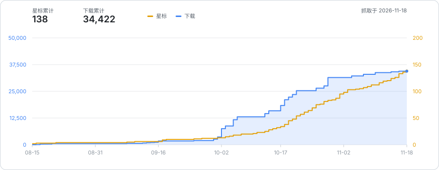

# DeepSeek Harness Android 版

[English](README.en.md) · [简体中文](README.md) · [한국어](README.ko.md) · [日本語](README.ja.md)

[](https://github.com/dphmoblie/deepseek-harness-android/releases)
[](https://github.com/dphmoblie/deepseek-harness-android/releases)
[](LICENSE)
[](https://github.com/dphmoblie/deepseek-harness-android/commits)
[](https://github.com/dphmoblie/deepseek-harness-android/pulls)
[](https://developer.android.com/)
[](https://developer.android.com/ndk/guides/abis)
[](https://kotlinlang.org/)
[](#qq-group)

<p align="center"></p>

**裝在手機裡的本機 AI 工作台。** 它將 [DeepSeek Harness](https://github.com/deepseek-ai/dsh)、Ubuntu 執行環境、對話工作階段、外掛系統與檔案管理整合到同一個 Android 應用程式中。在你主動授權後，AI 也能搭配 Shizuku 執行裝置端命令列工作，或透過無障礙服務輔助操作指定的應用程式。

不需要 Root 權限。Ubuntu 環境透過 [PRoot](https://github.com/proot-me/proot) 直接在一般手機上執行，主控台由內建 WebView 呈現，模型推論則連線至你自行設定的模型服務或 DeepSeek 帳號。

| 項目 | 說明 |
| --- | --- |
| 套件名稱 | `io.deepseekharness.mobile` |
| 系統需求 | Android 8.0（API 26）以上 |
| 目標應用副螢幕 | Android 10（API 29）以上，需搭配 Shizuku 使用 |
| CPU 架構 | 僅支援 `arm64-v8a`（64 位元 ARM） |
| 內建環境 | Ubuntu 24.04 ARM64 · Node.js 24.19 · `@deepseek-ai/dsh` 0.2.2-rc.5 |
| 開源授權 | MIT（內建執行環境元件沿用各自授權，見[授權條款](#授權條款)） |

## 目錄

- [功能特色](#功能特色)
- [運作原理](#運作原理)
- [安裝與首次設定](#安裝與首次設定)
- [模型供應商](#模型供應商)
- [選用的 Shizuku 與自動化整合](#選用的-shizuku-與自動化整合)
- [目標應用副螢幕（實驗功能）](#目標應用副螢幕實驗功能)
- [從原始碼建置](#從原始碼建置)
- [安全與隱私](#安全與隱私)
- [參與貢獻](#參與貢獻)
- [專案數據](#專案數據)
- [授權條款](#授權條款)
- [相關文件](#相關文件)

## 功能特色

### 本機執行與行動端體驗

- **免 Root 執行完整 Linux 環境**：透過 PRoot 在手機本機執行 Ubuntu 24.04，不需雲端伺服器或遠端桌面，也不強制註冊應用程式帳號。
- **開箱即用、支援離線安裝**：官方發行版 APK 已內建經過驗證的 `rootfs.bundle` 映像檔，無網路也能完成環境安裝；同時支援經 SHA-256 驗證的遠端來源，並提供斷點續傳與版本切換。
- **專為手機重新整理的介面**：底部以「首頁、外掛、設定」三大分頁組織功能，調適窄螢幕、橫向與安全區域，並將歷史工作階段管理整合至首頁。
- **內建終端機與外部瀏覽器**：應用程式內可直接開啟 Ubuntu 終端機與（選用）Shizuku 裝置終端機；也能從診斷頁面將完整的 Harness 主控台交給 Chrome 等外部瀏覽器開啟使用。
- **設定自動儲存與選用預先啟動**：變更一般設定後離開頁面即自動儲存；若希望點擊「開啟對話」時更快進入，可在設定中開啟「開啟應用程式時預先啟動服務」（預設關閉，不會自動跳轉畫面）。
- **個人化外觀與主題同步**：支援自訂圖片或影片背景，自由調整卡片底色、透明度、模糊程度與強調色，並可將主題與背景同步至 DSH 主控台。

### 模型、外掛與檔案管理

- **多模型供應商與官方登入**：內建 DeepSeek、OpenAI、Anthropic、Google Gemini、OpenRouter、Groq、xAI、Mistral，同時支援任何 OpenAI 相容的自訂端點；DeepSeek 另支援直接登入官方帳號。
- **彈性的外掛管理**：支援透過 npm 套件名稱、HTTPS 壓縮檔連結或 `git+https` 儲存庫匯入外掛，自由啟用或停用套件與子外掛；更新時會依規則保留資料，並支援一鍵還原至上一版本。涉及原生編譯或特殊相依性的外掛限制詳見[外掛管理](docs/design/插件管理.md)。
- **整合式檔案管理與分享**：內建「檔案管理」頁面統一管理投遞區（inbox / outbox）與自訂共享資料夾，支援建立資料夾、工作區歸檔匯入匯出，以及直接將工作區檔案分享或交由其他應用程式開啟。
- **加密資料備份**：支援備份與還原工作階段、設定、模型憑證、技能與附件，正式環境逐檔透過 Android Keystore 加密保護。

### 背景體驗與排錯工具

- **選用懸浮球與背景保活**：開啟前景保活服務可提升背景存活率（仍受系統記憶體、省電與各廠牌背景策略限制）。懸浮球預設貼邊收合為細線以免遮擋畫面，輕觸展開快捷選單，長按直接叫出可拖曳的 AI 對話小視窗；背景通知則會自動折疊成群組摘要，減少通知列干擾。
- **17 項應用程式內自我檢查與一鍵修復**：不需手動輸入指令排錯，自檢涵蓋 bash、Node.js、Landlock 沙盒、PTY 終端機、目錄可寫性、ripgrep、C / Make / Python 編譯環境，以及手機端外掛連結、無障礙、懸浮視窗與系統 WebView 狀態；偵測到執行權限或目錄遺失時可就地修復，剩餘空間低於 512 MB 時也會主動提醒。
- **易讀的日誌與錯誤指引**：可隨時在應用程式內檢視診斷日誌與執行日誌（支援關鍵字篩選與等級標色），遇到缺少憑證、連接埠被占用、外掛載入失敗等常見問題時直接提供原因與處理建議。

## 運作原理

應用程式整體分為三層：

1. **管理介面（Capacitor + React）**：負責環境安裝與版本管理、服務控制、模型設定、內建終端機與檔案管理。
2. **原生執行層（Kotlin）**：負責映像檔驗證與解壓縮、PRoot 執行器管理、Harness 與終端機行程監督、權限與安全審批，以及授權後的 Shizuku 通道連線。
3. **Ubuntu 執行環境（PRoot）**：於 Ubuntu 24.04 內透過固定入口啟動 `dsh web`，僅監聽本機回環位址 `127.0.0.1`。Node.js 預載模組會攔截並驗證每次啟動產生的臨時權杖，內建 WebView 亦限制在相同來源範圍內。

完整架構與安全邊界說明見 [docs/ARCHITECTURE.md](docs/ARCHITECTURE.md)。

## 安裝與首次設定

1. 前往 [Releases](https://github.com/dphmoblie/deepseek-harness-android/releases) 頁面下載最新版 APK，並閱讀該版本的發行說明。
2. 在手機上安裝 APK（依系統提示允許安裝來自可信來源的應用程式）。
3. 首次開啟應用程式，依照三步驟引導完成設定：**免費聲明 → 設定模型 → 安裝執行環境**：
   - **免費聲明**：本專案完全免費且開源，官方下載管道僅有本 GitHub Releases；沒有付費版或付費代裝，若遇收費請立即退款並檢舉。
   - **設定模型**：貼上 DeepSeek API 金鑰並儲存（為避免輸入法誤改或貼上漏字，首次設定預設明文顯示金鑰，並自動清除前後空白、`Bearer ` 前綴與引號）。
   - **安裝執行環境**：官方 APK 已內建映像檔，直接點擊「安裝執行環境」等待完成即可，無需連網；自行編譯且未打包映像檔的 APK 可點擊「安裝失敗？前往線上下載其他版本」至版本管理頁連網下載並切換。
4. 設定完成後，回到首頁點擊**開啟對話**即可開始使用。

之後可在 **設定 → 模型與金鑰** 調整模型設定，在 **設定 → Ubuntu 執行環境 / 版本管理** 管理環境與版本。詳細步驟與排錯方式見 [首次設定指南](docs/operations/首次配置.md)。

### 執行需求

- Android 8.0 以上系統，**arm64-v8a**（64 位元 ARM）處理器裝置。
- 約數 GB 可用儲存空間，用於存放解壓縮後的 Ubuntu 環境與工作階段資料。
- 至少一組受支援模型供應商的 API 金鑰、DeepSeek 官方帳號，或相容的自訂模型端點。
- 官方 APK 支援離線安裝執行環境；自行建置且未內建映像檔的 APK 首次安裝需連網下載。

## 模型供應商

- **內建供應商**：DeepSeek、OpenAI、Anthropic、Google Gemini、OpenRouter、Groq、xAI、Mistral。
- **自訂供應商**：支援新增任何 OpenAI 相容端點（自訂網址、API 金鑰與模型清單）。
- **線上取得模型**：點擊「取得模型」可從上游拉取可用模型清單並自動帶入預設項目，同時保留你手動調整過的自訂模型設定與上下文長度。

API 金鑰在管理端透過 Android Keystore 加密保存，執行時寫入 Harness 私有憑證檔 `~/.dsh/.credentials.yaml`（權限 `0600`），絕不回傳給 WebView。儲存變更時若服務正在執行，應用程式會自動重啟 Harness 讓新設定立即生效。

### DeepSeek 帳號登入

在 **設定 → 模型與金鑰** 點擊「登入 DeepSeek 帳號」後，應用程式會開啟 Harness，由側邊欄「更多」選單完成官方登入即可。授權完成返回設定頁會自動更新登入狀態，且不會遺失尚未儲存的 API 金鑰草稿；帳號登入與 API 金鑰彼此獨立。

登入流程僅放行官方 `https://platform.deepseek.com/dsh/authorize` 開啟系統瀏覽器，回呼僅放行 `/oauth/callback`，應用程式本身不會讀取或轉傳你的帳號權杖。

## 選用的 Shizuku 與自動化整合

Shizuku 完全選用，不會隨應用程式一同安裝：

1. 先依 [Shizuku](https://shizuku.rikka.app/) 官方指引在手機上安裝並啟動服務（例如透過無線偵錯）。
2. 開啟本應用程式並授予 Shizuku 權限；之後只要 Shizuku 正在執行且授權有效，應用程式會自動重連，失敗時也可手動點擊**連線 Shizuku**。
3. 在 **設定 → Shizuku 與裝置自動化** 連線成功後，視需求開啟「允許 AI 呼叫 Shell」。開啟後將持續生效，直到你手動關閉。

啟用後，AI 可透過 Shizuku 的 Android Shell 權限讀寫指定檔案、查詢應用程式行程與狀態。**Shizuku 提供的是標準 Shell 權限而非 Root 權限**；若你在已 Root 裝置上額外啟用進階根通道，高風險指令會受到分級審批與原生警告確認頁保護，應用程式內亦提供高風險檔案與指令防護總開關。指令內容與輸出不會寫入診斷日誌，仍請避免讓 AI 讀取簡訊、聯絡人、密碼或權杖等敏感資料。

- **無障礙自動化**：需在系統設定中手動開啟無障礙服務，並在應用程式內將允許操作的應用程式加入白名單。系統設定、權限視窗、付款、驗證碼與密碼畫面均會被原生服務強制攔截，且無法略過鎖定畫面。
- **故障隔離**：Shizuku 未啟動、未授權或斷線時，僅裝置工具會顯示錯誤，不影響 Ubuntu 執行環境與一般對話。
- **Shizuku 更新後連線逾時**：更新 Shizuku 應用程式後，舊版背景服務可能仍在運作而導致連線逾時，只需在 Shizuku 內重啟服務（或重開機）再重試即可。此外，0.3.5 及更早版本與 Shizuku 13.6.0 有相容問題，升級至 **0.3.6 以上版本**即可解決。

## 目標應用副螢幕（實驗功能）

在 **設定 → AI Shell → 目標應用副螢幕（實驗功能）** 中選擇目標應用程式，可嘗試將其啟動到獨立的虛擬顯示器中，並透過應用程式內預覽頁或可拖曳小視窗檢視與操作（此小視窗顯示的是目標應用程式畫面，與 AI 對話懸浮視窗互不干擾）。

- **前置條件**：Android 10 以上、已授權並連線 Shizuku、已開啟 AI Shell；螢幕鎖定或關閉時會自動暫停讀取與輸入。
- **支援能力**：檢視副螢幕狀態與效能指標、擷取 PNG 畫面、讀取副螢幕專屬無障礙節點樹與免截圖結構變化偵測、點擊／滑動／返回、中文文字輸入（無障礙寫入並支援剪貼簿備援）、15/30/60 fps 等影格率檔位切換與結束工作階段。畫面採逐幀擷取，並非視訊串流編碼。
- **目前限制**：此功能仍屬實驗階段，不同機型、系統版本與第三方應用程式的相容性差異較大；升級 APK 後，既有的執行環境需同步更新或重新封裝 `dsh-mobile-shizuku` 外掛才能使用新增工具。詳細機制、介面與實機測試記錄見 [目標應用副螢幕說明](docs/design/目标应用副屏.md)。

## 從原始碼建置

### 建置環境

- Node.js `^22.19.0` 或 `>=24.0.0`，以及 [pnpm](https://pnpm.io/) 11
- Android SDK 35、NDK、CMake 3.22.1、JDK 21、Gradle 8.11.1
- 來自 Operit2 工具鏈、與版本對應的 ARM64 PRoot 執行器與載入器（`libdsh_proot.so`、`libdsh_proot_loader.so`），確切版本與雜湊見 [THIRD_PARTY_NOTICES.md](THIRD_PARTY_NOTICES.md)
- 如需建置離線完整版 APK，另需準備同版本產生的 `runtime-manifest.json` 與 `rootfs.bundle`

### 編譯 Web 與 Android 專案

```bash
pnpm install --frozen-lockfile
pnpm run build          # TypeScript 型別檢查 + Vite 正式建置
pnpm run android:sync   # 同步前端產物至 Android 專案
pnpm run android:open   # 使用 Android Studio 開啟，或直接以 Gradle 建置
```

開發除錯時可省略內建映像檔，改為同時設定 `DSH_RUNTIME_MANIFEST_URL` 與 `DSH_RUNTIME_MANIFEST_SHA256` 指定遠端驗證清單。完整建置與簽章流程見 [docs/android.md](docs/android.md)。

### 執行檢查與測試

```bash
pnpm test          # Vitest 單元測試
pnpm --dir scripts/runtime-profile install --frozen-lockfile --ignore-scripts  # 安裝外掛測試相依套件
pnpm run test:scripts
pnpm lint          # ESLint 檢查（須零警告通過）
```

## 安全與隱私

- **資料流向透明**：本機執行主控台不等於本機離線大型模型。你的對話、AI 工具讀取的檔案內容與截圖可能會傳送至所選的模型服務；單純在本機預覽副螢幕則不會上傳影像。請僅授權目前工作所需的權限與資料。
- **僅限本機存取**：Harness 服務僅繫結 `127.0.0.1`，內建 WebView 會封鎖回環來源以外的導覽與資源請求。
- **單次臨時權杖**：每次啟動 Harness 都會以 `SecureRandom` 產生全新的 256 位元隨機權杖保護 HTTP 與 WebSocket 請求；權杖僅存於記憶體，不寫入硬碟、URL 或日誌，也不回傳給前端腳本。
- **憑證加密隔離**：管理端 API 金鑰由 Android Keystore 加密保存，執行時僅透過 `0600` 權限私有檔案提供給 Harness，絕不回傳 WebView。
- **可驗證的執行環境供應鏈**：清單與映像檔均經 Schema 驗證與 SHA-256 摘要固定；下載僅允許 HTTPS 並攔截指向內網的 DNS 解析，解壓縮嚴格防範路徑穿越與非法裝置節點，遇到異常即直接中止而不使用殘缺檔案。
- **兼顧隱私的稽核日誌**：原生稽核日誌存放於禁止備份的應用程式私有目錄，依 UTC 日期輪替並保留 90 天，僅記錄固定事件類型與結果狀態，絕不包含 URL、指令原文、權杖或終端機內容。
- **零追蹤、無廣告**：不設應用程式自有帳號系統，不含廣告，也不蒐集任何遙測資料。

## 參與貢獻

歡迎前往 <https://github.com/dphmoblie/deepseek-harness-android> 提交 Issue 與 Pull Request。

送出變更前請盡量保持修改聚焦、為新行為補齊單元測試，並確認 `pnpm lint` 與 `pnpm test` 通過。涉及安全機制的異動必須維持 [docs/ARCHITECTURE.md](docs/ARCHITECTURE.md) 定義的邊界，不得削弱回環存取控制、雜湊驗證、入口白名單或 Shizuku UserService 契約。

### 貢獻者

[](https://github.com/dphmoblie/deepseek-harness-android/graphs/contributors)

歡迎更多開發者加入，期待在這裡看見你的名字。

<a id="qq-group"></a><a id="community-qq-group"></a>
### 交流社群

- **QQ 交流群：1108895375** —— 歡迎加入提問交流、回報問題與接收新版本發布通知。

## 專案數據



黃線代表 GitHub Star 累計成長趨勢，藍線代表各版本 Release 資產的累計下載次數（依各版本發布日期累加繪製）。圖表由 `stats-chart` 工作流程每日自動更新，也可在本機執行 `pnpm run chart:stats` 重新產生。

## 授權條款

本儲存庫中的應用程式程式碼採 [MIT 授權條款](LICENSE) 開源。

官方發行版 APK 同時包含並依各自開源授權再散布第三方執行環境元件，包含 PRoot（GPL-2.0-or-later）、Operit2 執行環境工具鏈（AGPL-3.0）、Ubuntu 24.04 軟體套件、Node.js，以及採用 MIT 授權的 DeepSeek Harness 執行環境與前端。完整元件清單、上游版本、驗證雜湊與授權原文見 [THIRD_PARTY_NOTICES.md](THIRD_PARTY_NOTICES.md)，並隨 APK 內建於 `assets/legal/` 目錄中。

## 相關文件

- [首次設定（三步驟完成並開始對話）](docs/operations/首次配置.md)
- [目標應用副螢幕與驗證範圍](docs/design/目标应用副屏.md)
- [應用程式讀取與無障礙自動化](docs/design/应用自动化能力.md)
- [外掛匯入、資料保留與還原](docs/design/插件管理.md)
- [投遞區與儲存權限](docs/design/存储权限与导入落点.md)
- [架構與安全邊界](docs/ARCHITECTURE.md)
- [行動裝置外掛相容設計](docs/mobile-plugin-compat.md)
- [專案狀態與實機測試記錄](docs/项目状态.md)
- [發行檢查清單](docs/RELEASE_CHECKLIST.md)
- [Android 平台建置說明](docs/android.md)
- [第三方開源聲明](THIRD_PARTY_NOTICES.md)
