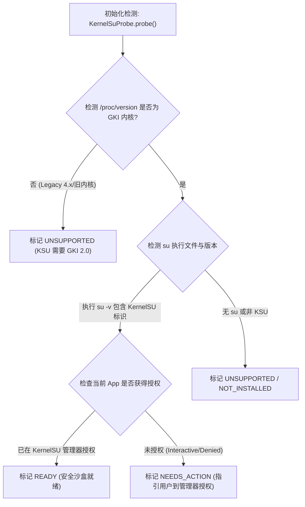

# KernelSU 高级 Root 通道与系统分区安全防护设计规范

> **状态：正式架构设计规范 (RFC)**
> **面向平台：Android 10+（API 29+）· Linux 内核 GKI 2.0（5.10 / 5.15 / 6.1+）· arm64-v8a**
> **相关文档：** [应用自动化能力.md](应用自动化能力.md) · [设备桥信任边界.md](设备桥信任边界.md) · [后台应用操作与窗口形态评估.md](后台应用操作与窗口形态评估.md)

---

## 1. 架构定位与设计原则

本项目当前在用户空间构建了完整的零门槛免 Root AI 运行环境（PRoot + Shizuku + AccessibilityService）。然而，PRoot 的 `ptrace`/`seccomp` 系统调用拦截机制在 Node.js I/O、包编译与并发进程调度上存在 **30%~70% 的客观性能损耗**，且无法触及宿主第三方应用私有数据目录（`/data/data/<pkg>`）。

本方案将 **Root 支持定义为「Tier 3: 极致极客 / 专用设备高级引擎」**，以 **KernelSU** 作为核心授权管理器。核心原则如下：

1. **非侵入式分级特权（Tiered Privilege）**：
   - **Tier 1（默认）：免 Root 纯用户态**。PRoot + 无障碍 + 前台服务，服务绝大多数普通主力机用户；
   - **Tier 2（进阶）：Shizuku ADB 态**。提供 `uid 2000 (shell)` 级自动化与副屏支持；
   - **Tier 3（高级）：KernelSU 态**。提供原生 `chroot` 裸机级性能与深度自动化，用户必须在设置深层显式开启。
2. **防变砖防御底线（Anti-Brick Shield）**：
   - 彻底拒绝让 LLM Agent 直接执行裸 Root。
   - 采用内核级 **Mount Namespace 隔离 + 物理块设备（Block Devices）硬屏蔽 + 系统核心分区只读锁定**，切断物理刷机与变砖路径。
3. **改动不落盘原则（Ephemeral OverlayFS）**：
   - 针对系统配置修改，一律走内存临时层（OverlayFS / tmpfs），物理分区保持只读，设备重启后物理状态绝对纯净。

---

## 2. 为什么选择 KernelSU 及其集成机制

### 2.1 传统 Root（Magisk）vs 内核 Root（KernelSU）

| 维度 | 传统 Magisk 方案 | KernelSU 方案（本方案选型） |
| :--- | :--- | :--- |
| **存在形态** | 用户态注入（修改 `init` / `zygisk` / `sepolicy`） | **内核空间原生集成**（运行于 Ring 0 内核态） |
| **金融应用与防检测** | 极易被银行、政务与 Play Integrity 探测并封禁 | **非授权应用完全不可见**，天然免疫金融反作弊检测 |
| **授权隔离机制** | 全局或简单的 UID 白名单，难以细粒度约束 | **内置 App Profile**，支持受控的特定系统调用与特权子集 |
| **文件系统修改** | 依赖用户态 Magic Mount 挂载传播 | **内核原生 OverlayFS**，性能极高，无上下文切换损耗 |
| **设备生态标准** | 适用于旧版 Android 与非 GKI 设备 | **Android 12+ GKI 2.0 事实标准**，代码干净无冗余 hack |

### 2.2 KernelSU 探测与握手协议

应用原生侧通过 `KernelSuProbe` 进行三层递进式安全握手：



---

## 3. 安全通道与系统分区保护体系（防变砖核心）

### 3.1 LLM 幻觉威胁模型
大语言模型自主生成 Shell 脚本时存在不可预测性：
- **意外删除或改写**：执行 `rm -rf /system/*` 或错误的变量展开导致清空系统；
- **底层块设备写入**：执行 `dd if=/dev/zero of=/dev/block/by-name/boot` 或 `mkfs.ext4`，瞬间造成设备死锁变砖；
- **分区重新挂载污染**：通过 `mount -o remount,rw /system` 破坏只读完整性。

安全通道的核心是：**把“不能碰物理系统分区”做成操作系统级别的物理限制，而不是仅仅依靠脆弱的正则表达式过滤。**

---

### 3.2 四层立体安全防御设计

```
[来自 Agent 的原生 Shell Payload]
                 │
                 ▼
 ┌───────────────────────────────────────────────────────────────┐
 │ 【第 1 道防线: 指令静态审计 (RootCommandGuard)】                 │
 │  - 阻断 fastboot / reboot bootloader / flash_erase / format   │
 │  - 阻断 setenforce 0 与未知块设备操作                        │
 └───────────────────────────────┬───────────────────────────────┘
                                 │ 审查通过
                                 ▼
 ┌───────────────────────────────────────────────────────────────┐
 │ 【第 2 道防线: 内核命名空间隔离 (Mount & PID Namespace)】       │
 │  - 注入 unshare -m -p -f 隔离 Mount 与 PID 命名空间            │
 │  - 隔离进程树内的所有挂载与文件操作，且阻断 /proc/<pid>/root 逃逸   │
 └───────────────────────────────┬───────────────────────────────┘
                                 │
                                 ▼
 ┌───────────────────────────────────────────────────────────────┐
 │ 【第 3 道防线: 物理块设备与系统硬锁定】                         │
 │  - mount -o remount,ro /system, /vendor, /product             │
 │  - mount -t tmpfs -o mode=0000,ro tmpfs /dev/block (屏蔽裸设备)│
 │  - mount -t proc proc /proc (挂载独立私有 procfs)              │
 └───────────────────────────────┬───────────────────────────────┘
                                 │
                                 ▼
 ┌───────────────────────────────────────────────────────────────┐
 │ 【第 4 道防线: 内存态无痕修改 (OverlayFS)】                     │
 │  - 允许向 /dev/tmpfs_overlay 写配置，重启或销毁即刻纯净还原   │
 └───────────────────────────────────────────────────────────────┘
```

#### 防线 1：静态指令审查（`RootCommandGuard`）
在命令进入底层前，原生侧解析其调用指令，快速阻断高危工具（协作防误触）：
- 致命命令阻断列表：`reboot (bootloader|recovery|edl|fastboot)`, `fastboot`, `flash_erase`, `blockdev`, `mkfs.*`, `wipe`, `setenforce 0`, `umount /dev/block`, `mount ... remount,rw /system` 等。

#### 防线 2：内核命名空间隔离（`unshare -m -p -f`）
执行前强制新建挂载与 PID 命名空间，挂载传播属性设置为 `private`：
```sh
unshare -m -p -f /system/bin/sh -c '
    # 设置本命名空间所有挂载私有化，不向 Android 全局传播
    mount --make-rprivate /
    ...
'
```

#### 防线 3：系统核心分区只读锁定、块设备遮蔽与独立 procfs
在隔离命名空间内，执行安全前置模板（`Security Prelude`）：
1. **只读强制锁定**：
   ```sh
   for p in /system /vendor /product /system_ext /odm /apex; do
       [ -d "$p" ] && mount -o remount,ro "$p" 2>/dev/null
   done
   ```
2. **块设备物理切断（Block Device Masking）**：
   ```sh
   # 将 /dev/block 挂载为不可读写的空 tmpfs (含 ro)，彻底断绝物理扇区直写链路
   mount -t tmpfs -o mode=0000,nosuid,nodev,ro tmpfs /dev/block
   ```
   **效果**：即使模型执行 `dd if=/dev/zero of=/dev/block/...`，在操作系统层必然直接收到 `EACCES (Permission denied)` 或 `ENOENT`，物理分区不受任何伤害。
3. **独立私有 procfs（防止 `/proc/1/root` 绕过）**：
   ```sh
   # 配合 PID 命名空间挂载当前空间私有 procfs，切断宿主全局 PID 1 根路径穿透
   mount -t proc proc /proc
   ```

#### 防线 4：OverlayFS 内存态无痕修改
若 AI 需要写入系统级证书或 hosts，改动只允许写入基于 RAM 的 OverlayFS 临时层：
```sh
mkdir -p /dev/dsh_overlay/upper /dev/dsh_overlay/work
mount -t overlay overlay -o lowerdir=/system/etc,upperdir=/dev/dsh_overlay/upper,workdir=/dev/dsh_overlay/work /system/etc
```
所有改动完全在内存驻留，退出任务或手机重启即完全回退，不污染物理系统。

---

## 4. “临时 Root” 可行性与成功率全景评估

| “临时 Root” 类别 | 核心机制与原理 | 成功率评估 | 架构判定与建议 |
| :--- | :--- | :--- | :--- |
| **1. KernelSU 会话级动态授权**<br>*(Session-based Token)* | • App 在常规状态下无 Root 权限；<br>• 仅当执行敏感/高级任务时，动态唤起 KernelSU Socket 握手；<br>• 会话关闭或应用切入后台 5 分钟超时后自动关闭 Root 进程。 | **99%（极高）**<br>依托内核原生支持，只要设备刷入 KernelSU，授权稳定度 100%。 | **采纳为首选模式**。<br>既能获得完整能力，又避免让应用长期以 UID 0 暴露在后台。 |
| **2. OverlayFS 临时无痕状态**<br>*(Stateless Ephemeral Root)* | • 通过只读 Namespace 与 RAM 临时挂载，所有写入操作仅生效于当次进程树；<br>• 重启或销毁沙盒后系统恢复纯净原厂状态。 | **95%（高）**<br>主流 GKI 内核（5.10+）完全支持内核态 OverlayFS。 | **采纳为执行底线**。<br>作为安全通道的强制配置。 |
| **3. 内核漏洞热提权**<br>*(Exploit-based Temp Root)* | • 在未解 BL 锁的官方 ROM 上，利用 CVE 漏洞（如 Dirty Pipe / Dirty COW）篡改内核 `task_struct.cred`。 | **< 1%（极低，已失效）**<br>现代 Android（12~15）具备严格的 CFI、KASLR、SMEP 和月度安全补丁。极易造成 Kernel Panic 死机。 | **坚决废弃**。<br>正规工程项目严禁使用漏洞提权黑产方案。 |

---

## 5. 原生接入改动规范与代码结构

改动分布在原生层与能力策略层，完全向下兼容现存通道：

```
android/app/src/main/java/io/deepseekharness/mobile/
├── accessibility/
│   └── DeviceCapabilityPolicy.kt        # [修改] 增加 KERNELSU_ROOT 能力探测与状态生成
└── shizuku/
    ├── KernelSuProbe.kt                 # [新增] KernelSU 状态检测与握手逻辑
    ├── RootSecurityWrapper.kt           # [新增] Namespace 隔离与防变砖安全脚本封装器
    └── DeviceCommandRunner.kt           # [修改] SHELL 命令分支接入安全 Root 调度
```

### 5.1 `RootSecurityWrapper.kt` 核心实现规格

```kotlin
package io.deepseekharness.mobile.shizuku

import java.util.Base64

/**
 * KernelSU 安全隔离执行封装器。
 * 注入 Mount Namespace 隔离脚本，执行系统分区强制只读锁定与 /dev/block 块设备屏蔽。
 */
object RootSecurityWrapper {

    /**
     * 将用户或 AI 的原始 Shell 脚本包装进带防变砖安全网的沙箱脚本中。
     */
    fun wrapWithProtection(rawScript: String): String {
        // 将原始脚本 Base64 编码，防止参数转义逃逸
        val encodedPayload = Base64.getEncoder().encodeToString(rawScript.toByteArray(Charsets.UTF_8))

        // 构造安全防线前置逻辑
        val sandboxScript = """
            # 1. 挂载命名空间私有化
            mount --make-rprivate / 2>/dev/null || true

            # 2. 核心系统物理分区只读重新挂载
            for p in /system /vendor /product /system_ext /odm /apex; do
                [ -d "${'$'}p" ] && mount -o remount,ro "${'$'}p" 2>/dev/null || true
            done

            # 3. 彻底阻断物理块设备，防止格式化与刷盘
            mount -t tmpfs -o mode=0000,nosuid,nodev,ro tmpfs /dev/block 2>/dev/null || true

            # 4. 挂载私有 procfs，阻断 /proc/<pid>/root 穿透
            mount -t proc proc /proc 2>/dev/null || true

            # 5. 执行原始 Payload (作为独立子 shell，结果状态透传)
            printf '%s' '$encodedPayload' | toybox base64 -d | /system/bin/sh -s
            exit_code=${'$'}?

            exit ${'$'}exit_code
        """.trimIndent()

        // 启动 unshare 隔离执行 (Mount + PID Namespace)
        val escapedSandbox = singleQuote(sandboxScript)
        return "unshare -m -p -f /system/bin/sh -c $escapedSandbox"
    }

    private fun singleQuote(text: String): String {
        return "'" + text.replace("'", "'\\''") + "'"
    }
}
```

### 5.2 `DeviceCommandRunner.kt` 分流逻辑改造

```kotlin
// DeviceCommandRunner.kt -> DeviceCommand.SHELL 分支
DeviceCommand.SHELL -> {
    if (param.isBlank() || param.toByteArray(Charsets.UTF_8).size > MAX_SHELL_SCRIPT_CHARS || param.any { it == '\u0000' || it == '\r' }) {
        throw RuntimeFailure("DEVICE_COMMAND_INVALID", "Shell 脚本为空、过长或包含非法控制字符")
    }

    // 静态高危指令阻断预审
    RootCommandGuard.verifySafe(param)

    val script = if (RootRuntimeSettings.isRootEngineEnabled() && KernelSuProbe.isReady()) {
        // 走 KernelSU + 安全沙箱隔离通道
        val safeWrapper = RootSecurityWrapper.wrapWithProtection(param)
        "su -c " + singleQuote(safeWrapper)
    } else {
        // 保持原样：走 Shizuku (UID 2000) 管道
        val encoded = Base64.getEncoder().encodeToString(param.toByteArray(Charsets.UTF_8))
        "printf '%s' '$encoded' | toybox base64 -d | /system/bin/sh -s"
    }

    Body(script, "\$?")
}
```

---

## 6. 前端与交互门禁设计

为确保普通用户不被误导，且明确知晓特权责任，设置层提供三道防护门禁：

1. **入口深度隐藏**：
   位于「设置 → 开发者与高级实验」区域，默认处于关闭状态（OFF）。
2. **显式风险告知与免责确认**：
   开启开关时弹出模态对话框，明确提示：
   > **「高级 KernelSU 引擎」说明：**
   > 开启后，AI 工具与本地运行时将获得 Superuser (UID 0) 特权。本应用已启用内核级命名空间隔离与只读分区锁定以防误操作变砖，但仍可能接触您的应用私有数据。请确保您信任运行的模型与插件。
3. **密码 / 生物识别强校验**：
   复用 [`AccessibilityAutomationPolicy.kt`](../android/app/src/main/java/io/deepseekharness/mobile/accessibility/AccessibilityAutomationPolicy.kt) 现有的白名单密码或系统生物识别（`BiometricPrompt`），必须验证通过后才允许持久化写入开启状态。
4. **设备能力看板实时展示**：
   在 [`DeviceCapabilityCard.tsx`](../src/components/DeviceCapabilityCard.tsx) 中增加 `kernelsu_root` 读数：
   - `ready`：KernelSU 已授权，安全隔离通道已激活；
   - `blocked`：检测到 KernelSU 但尚未在管理器中授权本应用；
   - `unsupported`：设备未检测到 KernelSU 内核支持。

---

## 7. 验收与测试用例矩阵

| 序号 | 测试场景 | 预期断言 |
| :--- | :--- | :--- |
| **TC-01** | 在沙箱内执行 `rm -rf /system/bin/sh` | 操作被拒，返回 `Read-only file system`，系统分区完好。 |
| **TC-02** | 在沙箱内执行 `dd if=/dev/zero of=/dev/block/...` | 操作被拒，返回 `Permission denied`，块设备处于屏蔽状态。 |
| **TC-03** | 在沙箱内读取目标应用数据库 `/data/data/com.example/databases` | 成功以 Root 权限读取数据内容并格式化回传。 |
| **TC-04** | 在沙箱内通过 OverlayFS 修改 `/system/etc/hosts` | 沙箱内读取为新 hosts 内容；设备重启或退出会话后，物理 hosts 还原为原厂内容。 |
| **TC-05** | 在未安装 KernelSU 的普通设备上运行 | 界面正确显示 `unsupported`，平滑回退至 Shizuku/无障碍通道，无报错崩溃。 |

---

## 8. 结论与总结

本设计方案在不破坏现有免 Root 架构的前提下，通过 **KernelSU 内核引擎 + 命名空间物理隔离**，以最小的工程代价完成了以下平衡：
- **性能飞跃**：具备切换至原生 `chroot` 的完整底层能力；
- **能力穿透**：打通宿主数据目录直接读取与内核级硬件事件交互；
- **安全兜底**：彻底阻断大模型因幻觉写入破坏系统分区或导致变砖的可能，形成严密闭环。
