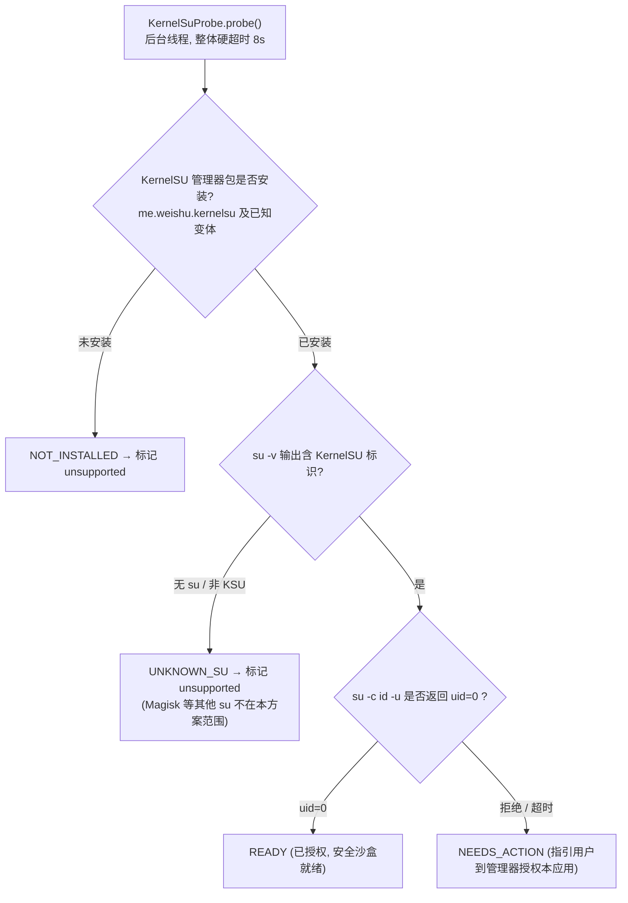

# KernelSU 高级 Root 通道与系统分区安全防护设计规范

> **状态：正式架构设计规范 (RFC)**
> **面向平台：Android 10+（API 29+）· Linux 内核 GKI 2.0（5.10 / 5.15 / 6.1+）· arm64-v8a**
> **相关文档：** [应用自动化能力.md](应用自动化能力.md) · [设备桥信任边界.md](设备桥信任边界.md) · [后台应用操作与窗口形态评估.md](后台应用操作与窗口形态评估.md)

---

## 1. 架构定位与设计原则

本项目当前在用户空间构建了完整的零门槛免 Root AI 运行环境（PRoot + Shizuku + AccessibilityService）。然而，PRoot 的 `ptrace`/`seccomp` 系统调用拦截机制在 Node.js I/O、包编译与并发进程调度上存在 **30%~70% 的客观性能损耗**，且无法触及宿主第三方应用私有数据目录（`/data/data/<pkg>`）。

本方案将 **Root 支持定义为「Tier 3: 极致极客 / 专用设备高级引擎」**，以 **KernelSU** 作为核心授权管理器。核心原则如下：

1. **非侵入式分级特权（Tiered Privilege）**：
   - **Tier 1（默认）：免 Root 纯用户态**。PRoot + 无障碍 + 前台服务，服务绝大多数普通主力机用户；
   - **Tier 2（进阶）：Shizuku ADB 态**。提供 `uid 2000 (shell)` 级自动化与副屏支持；
   - **Tier 3（高级）：KernelSU 态**。提供原生 `chroot` 裸机级性能与深度自动化，用户必须在设置深层显式开启。
2. **防变砖防御底线（Anti-Brick Shield）**：
   - 彻底拒绝让 LLM Agent 直接执行裸 Root。
   - 采用内核级 **Mount Namespace 隔离 + 物理块设备（Block Devices）硬屏蔽 + 系统核心分区只读锁定**，切断物理刷机与变砖路径。
3. **改动不落盘原则（Ephemeral OverlayFS）**：
   - 针对系统配置修改，一律走内存临时层（OverlayFS / tmpfs），物理分区保持只读，设备重启后物理状态绝对纯净。
4. **授权主体必须是本应用自身 UID（Per-App Grant）**：
   - Root 调用一律从**本应用自身进程**经 `ProcessBuilder("su", ...)` 发起；**严禁经 Shizuku 会话（uid 2000）转发 `su`**。
   - 原因：KernelSU 对 shell（uid 2000）的 `su` 请求默认放行且不可在管理器中按应用撤销；经 Shizuku 借道后，KSU 看到的调用方是 uid 2000 而非本应用——既绕过了「管理器授权本应用」这道门禁（第 2.2 节将形同虚设），也让任何获得 Shizuku 授权的应用连带获得 Root，信任边界彻底失守。

---

## 2. 为什么选择 KernelSU 及其集成机制

### 2.1 传统 Root（Magisk）vs 内核 Root（KernelSU）

| 维度 | 传统 Magisk 方案 | KernelSU 方案（本方案选型） |
| :--- | :--- | :--- |
| **存在形态** | 用户态注入（修改 `init` / `zygisk` / `sepolicy`） | **内核空间原生集成**（运行于 Ring 0 内核态） |
| **金融应用与防检测** | 极易被银行、政务与 Play Integrity 探测并封禁 | **非授权应用完全不可见**，天然免疫金融反作弊检测 |
| **授权隔离机制** | 全局或简单的 UID 白名单，难以细粒度约束 | **内置 App Profile**，支持受控的特定系统调用与特权子集 |
| **文件系统修改** | 依赖用户态 Magic Mount 挂载传播 | **内核原生 OverlayFS**，性能极高，无上下文切换损耗 |
| **设备生态标准** | 适用于旧版 Android 与非 GKI 设备 | **Android 12+ GKI 2.0 事实标准**，代码干净无冗余 hack |

### 2.2 KernelSU 探测与握手协议

应用原生侧通过 `KernelSuProbe` 进行分层探测。先明确两个事实，避免把协议想象得过于复杂：

- **KernelSU 没有「会话级动态授权」API**。授权是管理器中针对本应用 UID 的**持久授权**（一次授予，直至用户撤销）。应用侧能做的只是「平时不持有 Root 进程，需要时临时创建，空闲超时回收」（见第 4 节）。
- **`su` 交互可能阻塞**（管理器弹窗等待用户点选）。探测与执行都必须离开主线程并带硬超时；任何一步失败只降级为受控状态，**不得崩溃、不得无提示失败**（项目硬约束）。

探测全部以**本应用自身 UID** 执行（`ProcessBuilder`，不经 Shizuku 会话），共四步：



说明：
- 不再以 `/proc/version` 的 GKI 判定作为前置硬门槛：KSU 官方以 GKI 2.0 为主，但也存在非 GKI 的手工集成；先查管理器与 `su` 标识更直接，内核信息仅记录进诊断。
- 探测链路上的每一步都按 `Throwable` 兜底；任何异常只记录诊断并落到 `unsupported`，禁止向上抛出终结进程。

---

## 3. 安全通道与系统分区保护体系（防变砖核心）

### 3.1 LLM 幻觉威胁模型
大语言模型自主生成 Shell 脚本时存在不可预测性：
- **意外删除或改写**：执行 `rm -rf /system/*` 或错误的变量展开导致清空系统；
- **底层块设备写入**：执行 `dd if=/dev/zero of=/dev/block/by-name/boot` 或 `mkfs.ext4`，瞬间造成设备死锁变砖；
- **分区重新挂载污染**：通过 `mount -o remount,rw /system` 破坏只读完整性。

安全通道的核心是：**把“不能碰物理系统分区”做成操作系统级别的物理限制，而不是仅仅依靠脆弱的正则表达式过滤。**

---

### 3.2 四层立体安全防御设计

```
[来自 Agent 的原生 Shell Payload]
                 │
                 ▼
 ┌───────────────────────────────────────────────────────────────┐
 │ 【第 1 道防线: 指令静态审计 (RootCommandGuard)】                 │
 │  - 阻断 fastboot / reboot bootloader / flash_erase / format   │
 │  - 阻断 setenforce 0 与未知块设备操作                        │
 └───────────────────────────────┬───────────────────────────────┘
                                 │ 审查通过
                                 ▼
 ┌───────────────────────────────────────────────────────────────┐
 │ 【第 2 道防线: 内核命名空间隔离 (Mount & PID Namespace)】       │
 │  - 注入 unshare -m -p -f，随后 mount --make-rprivate /        │
 │  - 隔离进程树内的所有挂载与文件操作，且阻断 /proc/<pid>/root 逃逸   │
 └───────────────────────────────┬───────────────────────────────┘
                                 │
                                 ▼
 ┌───────────────────────────────────────────────────────────────┐
 │ 【第 3 道防线: 物理块设备与系统硬锁定】                         │
 │  - 按挂载点判定后 mount -o remount,ro 系统分区 (尽力而为)      │
 │  - mount -t tmpfs -o mode=0000,nosuid,nodev,ro tmpfs /dev/block│
 │  - mount -t proc proc /proc (挂载独立私有 procfs)              │
 │  - 可选加固档: setpriv 裁减 CAP_SYS_ADMIN / CAP_MKNOD 上限     │
 └───────────────────────────────┬───────────────────────────────┘
                                 │
                                 ▼
 ┌───────────────────────────────────────────────────────────────┐
 │ 【第 4 道防线: 内存态无痕修改 (OverlayFS)】                     │
 │  - 允许向 /dev/tmpfs_overlay 写配置，重启或销毁即刻纯净还原   │
 └───────────────────────────────────────────────────────────────┘
```

#### 防线 1：静态指令审查（`RootCommandGuard`）
在命令进入底层前，原生侧解析其调用指令，快速阻断高危工具（协作防误触）：
- 致命命令阻断列表：`reboot (bootloader|recovery|edl|fastboot)`, `fastboot`, `flash_erase`, `blockdev`, `mkfs.*`, `wipe`, `setenforce 0`, `umount /dev/block`, `mount ... remount,rw /system` 等。

> **与既有原则的关系（有意收窄，需明说）**：本项目 Shizuku 通道在 `DeviceCommandRunner.kt` 中刻意**不使用关键字黑名单**（「命令的实际能力由用户授予的身份决定」）。Root 通道引入黑名单是对该原则的有意收窄——UID 0 的破坏半径与 uid 2000 完全不同。但黑名单永远不完整（可编码混淆、可间接调用），它只是纵深防御的第一层，硬性保证只能来自防线 2~4 与 KernelSU App Profile。该审查**只作用于 Root 通道**，Shizuku 通道行为保持不变。

#### 防线 2：内核命名空间隔离（`unshare -m -p -f`）
执行前强制新建挂载与 PID 命名空间，挂载传播属性设置为 `private`：
```sh
unshare -m -p -f /system/bin/sh -c '
    # 设置本命名空间所有挂载私有化，不向 Android 全局传播
    mount --make-rprivate /
    ...
'
```
**可用性兜底**：少数 ROM 的 toybox 构建不含 `unshare`。封装器先以 `command -v unshare` 探测；缺失时不硬失败——降级为「无命名空间隔离 + 强化防线 1 审查 + 依赖 App Profile 硬约束」并记录诊断，由能力看板如实展示降级状态。

#### 防线 3：系统核心分区只读锁定、块设备遮蔽与独立 procfs
在隔离命名空间内，执行安全前置模板（`Security Prelude`）：
1. **只读强制锁定（尽力而为，非硬保证）**：
   ```sh
   for p in /system /vendor /product /system_ext /odm; do
       mountpoint -q "$p" && mount -o remount,ro "$p" 2>/dev/null
   done
   ```
   注意：System-as-Root 设备上 `/system` 通常不是独立挂载点，`/apex` 由若干独立挂载组成，因此必须按挂载点判定并容忍单点失败。这些分区本就受 dm-verity 保护，此步是补强而非根基。
2. **块设备物理切断（Block Device Masking）**：
   ```sh
   # 将 /dev/block 挂载为不可读写的空 tmpfs (含 ro)，彻底断绝物理扇区直写链路
   mount -t tmpfs -o mode=0000,nosuid,nodev,ro tmpfs /dev/block
   ```
   **效果**：即使模型执行 `dd if=/dev/zero of=/dev/block/...`，在操作系统层必然直接收到 `EACCES (Permission denied)` 或 `ENOENT`，物理分区不受任何伤害。
3. **独立私有 procfs（防止 `/proc/1/root` 绕过）**：
   ```sh
   # 配合 PID 命名空间挂载当前空间私有 procfs，切断宿主全局 PID 1 根路径穿透
   mount -t proc proc /proc
   ```
4. **能力上限裁减（可选加固档，默认开启；挂载类任务显式关闭）**：
   ```sh
   # 挂载前置完成后、执行 payload 前，裁掉可撤销上述防护的能力
   command -v setpriv >/dev/null 2>&1 && \
       setpriv --bounding-set=-sys_admin,-mknod --inh-caps=-sys_admin,-mknod \
               --ambient-caps=-sys_admin,-mknod /system/bin/sh -s
   ```

> **诚实的边界声明（不做绝对化承诺）**：payload 以 UID 0 运行，若保留 `CAP_SYS_ADMIN` / `CAP_MKNOD`，可卸载 tmpfs 遮蔽、或在 `/dev`（无 `nodev` 的 tmpfs）下重新 `mknod` 块设备节点，绕过防线 3。因此上述措施属于**纵深防御**而非形式化保证：
> - **硬性保证**应交给 KernelSU **App Profile** 在管理器侧固化：为本应用配置能力上限（capability bounding）、独立 SELinux context、模块挂载隔离（umount modules by default）。这是唯一无法被 UID 0 payload 自行撤销的约束层；
> - 「加固档」（裁减能力，默认）与「挂载能力档」（需要 OverlayFS 的任务）在配置中显式区分，避免为挂载能力长期放弃硬约束。

#### 防线 4：OverlayFS 内存态无痕修改
若 AI 需要写入系统级证书或 hosts，改动只允许写入基于 RAM 的 OverlayFS 临时层：
```sh
mkdir -p /dev/dsh_overlay/upper /dev/dsh_overlay/work
mount -t overlay overlay -o lowerdir=/system/etc,upperdir=/dev/dsh_overlay/upper,workdir=/dev/dsh_overlay/work /system/etc
```
所有改动完全在内存驻留，退出任务或手机重启即完全回退，不污染物理系统。

> **可见性边界（必须知晓）**：OverlayFS 挂在**私有命名空间**内，改动只对沙箱进程树可见，对系统服务与其他应用**不可见**。因此「改 hosts / 装系统级证书」若目标是全局生效，**不能**走通用沙箱通道——必须做成独立的、固定模板的、需用户单独确认的原子能力（完成后显式卸载还原），而不是把命名空间传播放开。通用 Shell 沙箱一律保持命名空间私有。

---

## 4. “临时 Root” 可行性与成功率全景评估

| “临时 Root” 类别 | 核心机制与原理 | 成功率评估 | 架构判定与建议 |
| :--- | :--- | :--- | :--- |
| **1. 应用侧会话化 Root 进程**<br>*(App-managed Root Session)* | • KernelSU 对本应用的授权是**持久授权**（管理器一次授予、可撤销），KSU 本身没有会话 Token API；<br>• 应用平时不持有 Root 进程，仅在执行高级任务时以**自身 UID** 经 `ProcessBuilder` 创建 `su` 会话；<br>• 会话空闲 5 分钟或应用退后台即由应用侧回收进程，Root 暴露面最小化。 | **高（工程经验估计）**<br>仅依赖 KSU 本身的授权稳定性，无额外内核组件。 | **采纳为首选模式**。<br>既能获得完整能力，又避免应用长期以 UID 0 暴露在后台。 |
| **2. OverlayFS 临时无痕状态**<br>*(Stateless Ephemeral Root)* | • 通过只读 Namespace 与 RAM 临时挂载，所有写入操作仅生效于当次进程树；<br>• 重启或销毁沙盒后系统恢复纯净原厂状态。 | **高（工程经验估计）**<br>主流 GKI 内核（5.10+）完全支持内核态 OverlayFS。 | **采纳为执行底线**。<br>作为安全通道的强制配置。 |
| **3. 内核漏洞热提权**<br>*(Exploit-based Temp Root)* | • 在未解 BL 锁的官方 ROM 上，利用 CVE 漏洞（如 Dirty Pipe / Dirty COW）篡改内核 `task_struct.cred`。 | **极低且趋于失效**<br>现代 Android（12~15）具备严格的 CFI、KASLR、SMEP 和月度安全补丁。极易造成 Kernel Panic 死机。 | **坚决废弃**。<br>正规工程项目严禁使用漏洞提权黑产方案。 |

> 表中成功率均为**工程经验估计**，用于方案取舍，非实测统计；落地后应以真机验收矩阵（第 7 节）的实际结果为准。

---

## 5. 原生接入改动规范与代码结构

改动分布在原生层与能力策略层，完全向下兼容现存通道：

```
android/app/src/main/java/io/deepseekharness/mobile/
├── capability/
│   └── DeviceCapability.kt              # [修改] DeviceCapabilityPolicy 增加 KERNELSU_ROOT 能力项
└── root/                                # [新增包] Root 与 Shizuku 的信任边界分开存放
    ├── KernelSuProbe.kt                 # [新增] KernelSU 状态检测（本应用 UID、带超时、不崩溃）
    ├── RootCommandGuard.kt              # [新增] 仅作用于 Root 通道的静态预审
    ├── RootSecurityWrapper.kt           # [新增] Namespace 隔离与防变砖安全脚本封装器
    ├── RootSessionShell.kt              # [新增] 本应用 UID 持有的 Root 会话（ProcessBuilder，空闲超时回收）
    └── RootCommandRunner.kt             # [新增] Root 通道执行器与结果协议
```

> **注意**：既有 [`DeviceCapabilityPolicy`](../android/app/src/main/java/io/deepseekharness/mobile/capability/DeviceCapability.kt) 位于 `capability/` 包而非 `accessibility/`；[`DeviceCommandRunner.kt`](../android/app/src/main/java/io/deepseekharness/mobile/shizuku/DeviceCommandRunner.kt)（Shizuku 通道）**不做修改**——SHELL 命令在调度入口按「Root 引擎开关 + KernelSuProbe 状态」分流到两条通道之一。Root 执行严禁写入 Shizuku PTY 会话（uid 2000 的 `su` 被 KernelSU 默认放行，会绕过本应用授权门禁，见原则 4）。

### 5.1 `RootSecurityWrapper.kt` 核心实现规格

```kotlin
package io.deepseekharness.mobile.root

import java.util.Base64

/**
 * KernelSU 安全隔离执行封装器。
 * 注入 Mount Namespace 隔离脚本，执行系统分区只读锁定、/dev/block 块设备屏蔽，
 * 以及（加固档）capability 上限裁减。
 */
object RootSecurityWrapper {

    /**
     * 将用户或 AI 的原始 Shell 脚本包装进带防变砖安全网的沙箱脚本中。
     * @param hardened 加固档：裁减 CAP_SYS_ADMIN/CAP_MKNOD（默认）；
     *                 需要 OverlayFS 挂载能力的任务显式传 false。
     */
    fun wrapWithProtection(rawScript: String, hardened: Boolean = true): String {
        // 将原始脚本 Base64 编码，防止参数转义逃逸
        val encodedPayload = Base64.getEncoder().encodeToString(rawScript.toByteArray(Charsets.UTF_8))

        // 加固档：payload 改经 setpriv 裁减能力上限后执行
        val execLine = if (hardened) {
            "command -v setpriv >/dev/null 2>&1 && exec setpriv --bounding-set=-sys_admin,-mknod " +
                "--inh-caps=-sys_admin,-mknod --ambient-caps=-sys_admin,-mknod /system/bin/sh -s || exec /system/bin/sh -s"
        } else {
            "exec /system/bin/sh -s"
        }

        // 构造安全防线前置逻辑
        val sandboxScript = """
            # 1. 挂载命名空间私有化
            mount --make-rprivate / 2>/dev/null || true

            # 2. 核心系统物理分区只读重新挂载（按挂载点判定，容忍 SAR 设备单点失败）
            for p in /system /vendor /product /system_ext /odm; do
                mountpoint -q "${'$'}p" && mount -o remount,ro "${'$'}p" 2>/dev/null || true
            done

            # 3. 彻底阻断物理块设备，防止格式化与刷盘
            mount -t tmpfs -o mode=0000,nosuid,nodev,ro tmpfs /dev/block 2>/dev/null || true

            # 4. 挂载私有 procfs，阻断 /proc/<pid>/root 穿透
            mount -t proc proc /proc 2>/dev/null || true

            # 5. 执行原始 Payload (作为独立子 shell，结果状态透传)
            printf '%s' '$encodedPayload' | toybox base64 -d | { $execLine; }
            exit_code=${'$'}?

            exit ${'$'}exit_code
        """.trimIndent()

        // unshare 缺失的 ROM 降级为无命名空间执行（探测见防线 2 兜底说明）
        val escapedSandbox = singleQuote(sandboxScript)
        return "if command -v unshare >/dev/null 2>&1; then " +
            "unshare -m -p -f /system/bin/sh -c $escapedSandbox; " +
            "else /system/bin/sh -c $escapedSandbox; fi"
    }

    private fun singleQuote(text: String): String {
        return "'" + text.replace("'", "'\\''") + "'"
    }
}
```

### 5.2 Root 通道分流与执行（不侵入 `DeviceCommandRunner.kt`）

调度入口（插件执行层）在收到 `shell` 命令时按以下逻辑分流：

```kotlin
if (RootRuntimeSettings.isRootEngineEnabled()) {
    when (KernelSuProbe.state()) {
        KernelSuState.READY ->
            // 本应用自身 UID 的 Root 会话：ProcessBuilder("su")，注入安全沙箱脚本
            RootCommandRunner.execute(RootSecurityWrapper.wrapWithProtection(param), timeoutMs)
        KernelSuState.NEEDS_ACTION -> throw RuntimeFailure(
            "KERNELSU_NOT_AUTHORIZED", "尚未在 KernelSU 管理器中授权本应用，请按指引完成授权")
        else -> throw RuntimeFailure(
            "KERNELSU_UNSUPPORTED", "未检测到可用的 KernelSU；如需设备 Shell 能力，请关闭 Root 引擎开关后使用 Shizuku 通道")
    }
} else {
    // 原路径：DeviceCommandRunner（Shizuku, uid 2000），代码与行为完全不变
}
```

约定：
- 新增受控错误码沿用现有 `explain/guidanceFor` 模式（见 `DeviceCommandRunner.kt`）：`KERNELSU_NOT_INSTALLED`、`KERNELSU_NOT_AUTHORIZED`、`KERNELSU_PROBE_TIMEOUT`、`KERNELSU_UNSUPPORTED`、`ROOT_COMMAND_REJECTED`（防线 1 拦截）——开启 Root 引擎后**不做静默回退**，必须以受控错误码如实告知，避免「用户以为在 Root 通道实际走了 Shizuku」的语义错位；
- 探测与会话调用全部在后台线程执行并带硬超时，异常按 `Throwable` 兜底，只允许产生受控错误码，禁止崩溃（项目硬约束）；
- 与 Shizuku 通道一致：脚本正文不写入任何日志；
- Root 会话空闲 5 分钟或应用退后台即回收进程（`RootSessionShell` 负责），再次使用时按需重建。

### 5.3 应用私有目录属主红线

Root 会话创建/修改的文件默认属主为 root。若写入本应用私有目录（`/data/data/<本应用包名>`），应用回到普通身份运行后将无法读写这些文件——轻则功能异常，重则启动即崩溃。红线：
- Root 通道**禁止**向本应用私有目录写入；确需中转的文件一律走既有投递区，由应用侧二次搬运并修正属主；
- 读取宿主第三方应用数据后，回传走内存管道，不在应用私目录落盘；
- 若必须落盘，落点限定 `/data/local/tmp` 或投递区，并在完成后 `chown` 回应用 UID 或删除。

---

## 6. 前端与交互门禁设计

为确保普通用户不被误导，且明确知晓特权责任，设置层提供三道防护门禁：

1. **入口深度隐藏**：
   位于「设置 → 开发者与高级实验」区域，默认处于关闭状态（OFF）。
2. **显式风险告知与免责确认**：
   开启开关时弹出模态对话框，明确提示：
   > **「高级 KernelSU 引擎」说明：**
   > 开启后，AI 工具与本地运行时将获得 Superuser (UID 0) 特权。本应用已启用内核级命名空间隔离与只读分区锁定以防误操作变砖，但仍可能接触您的应用私有数据。请确保您信任运行的模型与插件。
3. **密码 / 生物识别强校验**：
   复用 [`AccessibilityAutomationPolicy.kt`](../android/app/src/main/java/io/deepseekharness/mobile/accessibility/AccessibilityAutomationPolicy.kt) 现有的白名单密码或系统生物识别（`BiometricPrompt`），必须验证通过后才允许持久化写入开启状态。
4. **设备能力看板实时展示**：
   在原生 [`DeviceCapabilityPolicy`](../android/app/src/main/java/io/deepseekharness/mobile/capability/DeviceCapability.kt) 中新增 `kernelsu_root` 能力项（含 `KERNELSU_NOT_INSTALLED` / `KERNELSU_NOT_AUTHORIZED` 原因码与 `open_kernelsu_manager` 动作码），并在 [`DeviceCapabilityCard.tsx`](../src/components/DeviceCapabilityCard.tsx) 的 `CAPABILITY_LABELS` / `REASON_NOTES` / `ACTION_NOTES` 中按既有闭集模式登记文案：
   - `ready`：KernelSU 已授权，安全隔离通道已激活；
   - `needs_action`：检测到 KernelSU 但尚未在管理器中授权本应用（动作为「前往 KernelSU 管理器授权」）；
   - `unsupported`：设备未检测到 KernelSU。

   状态命名沿用既有四态闭集（`ready` / `needs_action` / `blocked` / `unsupported`），不新造状态词。

---

## 7. 验收与测试用例矩阵

| 序号 | 测试场景 | 预期断言 |
| :--- | :--- | :--- |
| **TC-01** | 在沙箱内执行 `rm -rf /system/bin/sh` | 操作被拒，返回 `Read-only file system`，系统分区完好。 |
| **TC-02** | 在沙箱内执行 `dd if=/dev/zero of=/dev/block/...` | 操作被拒，返回 `Permission denied`，块设备处于屏蔽状态。 |
| **TC-03** | 在沙箱内读取目标应用数据库 `/data/data/com.example/databases` | 成功以 Root 权限读取数据内容并格式化回传。 |
| **TC-04** | 在沙箱内通过 OverlayFS 修改 `/system/etc/hosts` | 沙箱内读取为新 hosts 内容；设备重启或退出会话后，物理 hosts 还原为原厂内容。 |
| **TC-05** | 在未安装 KernelSU 的普通设备上运行 | 界面正确显示 `unsupported`，SHELL 走 Shizuku/无障碍通道，无报错崩溃。 |
| **TC-06** | 已装 KernelSU 但未授权本应用 | SHELL 调用返回受控码 `KERNELSU_NOT_AUTHORIZED`，界面给出前往管理器授权的指引，无崩溃、无静默回退。 |
| **TC-07** | 授权在 Root 会话存活期间被用户在管理器撤销 | 下一条命令返回受控错误码，进程不崩溃，会话被回收。 |
| **TC-08** | Root 会话空闲 5 分钟 / 应用退后台 | Root 进程被回收，`ps` 中无残留 `su` 子进程；再次使用时按需重建。 |
| **TC-09** | 探测期间管理器授权弹窗无人处理（阻塞） | 硬超时后落到 `needs_action`，主线程无 ANR，应用不闪退。 |
| **TC-10** | Root 通道尝试写入本应用私有目录 | 被红线校验拒绝，返回受控错误码；应用私有目录内无 root 属主文件残留。 |
| **TC-11** | toybox 缺失 `unshare` / `setpriv` 的 ROM | 按防线 2/3 的探测逻辑降级执行并在能力看板如实展示降级状态，不硬失败。 |

---

## 8. 结论与总结

本设计方案在不破坏现有免 Root 架构的前提下，通过 **KernelSU 内核引擎 + 本应用 UID 直连 Root 会话 + 命名空间隔离**，以最小的工程代价完成以下平衡：
- **性能飞跃**：具备切换至原生 `chroot` 的完整底层能力（接入规范见下方后续工作）；
- **能力穿透**：打通宿主数据目录直接读取与内核级硬件事件交互；
- **授权可信**：Root 授权主体是本应用自身 UID，KernelSU 管理器对本应用的授予/撤销与 App Profile 约束始终生效，不被 Shizuku 等中间通道绕过；
- **安全兜底**：「静态预审 + 命名空间隔离 + 块设备遮蔽 + 能力裁减 + KernelSU App Profile」构成纵深防御，显著抬高幻觉命令的破坏门槛。其中只有 App Profile（能力上限 + SELinux context）是无法被 UID 0 payload 自行撤销的硬性保证，其余为补强层——本方案对此保持诚实，不做绝对化承诺。

> **后续工作（本文不展开）**：Tier 3 的 `chroot` 运行时接入——复用现有 `rootfs.bundle`，以 `mount --bind` 准备 `/dev` `/proc` `/sys` 后 `chroot` 执行 node 运行时。注意 `chroot` 本身不是安全边界（持 `CAP_SYS_ADMIN` 可逃逸），其安全性仍由本方案的命名空间、能力裁减与 App Profile 层承担。

---

## 9. 审查意见与遗留建议（2026-10-15 评审）

本节为方案评审后沉淀的待决策事项，实施前需逐项给出结论。

### 9.1 已修正的原始缺陷（评审记录）

1. **授权主体缺陷（已修正，见原则 4）**：原方案在 Shizuku 会话（uid 2000）内转发 `su -c`。KernelSU 对 shell uid 的 `su` 默认放行且不可按应用撤销，会绕过「管理器授权本应用」门禁，并让所有 Shizuku 授权应用连带获得 Root。已改为本应用自身 UID 直连。
2. **虚构 API 与伪精确数字（已修正，见第 2.2 / 4 节）**：「KernelSU Socket 握手 / 会话级动态授权」不存在，KSU 授权为持久授权；成功率数字统一标注为工程经验估计。
3. **防御能力夸大（已修正，见防线 3 边界声明）**：UID 0 payload 保留 `CAP_SYS_ADMIN` / `CAP_MKNOD` 时可自行撤销防线 3；硬性保证只能来自 App Profile。
4. **引用错误（已修正，见第 5 节）**：`DeviceCapabilityPolicy` 实际位于 `capability/DeviceCapability.kt`；Root 通道静态黑名单与 Shizuku 通道「不使用黑名单」原则的关系已显式说明为有意收窄。
5. **内部不一致（已修正，见防线 4）**：私有命名空间内 OverlayFS 改动对系统全局不可见；图示与代码的命名空间私有化方式已统一。
6. **缺失风险项（已补充）**：Root 写应用私有目录的属主红线（§5.3）、探测超时与不崩溃约束（§2.2）、`chroot` 接入说明（§8 后续工作）。

### 9.2 待决策事项

1. **App Profile 落地方式**：App Profile 是唯一无法被 UID 0 payload 撤销的硬约束，但需用户在 KernelSU 管理器中手动配置（KSU Next / SukiSU 支持模板）。需补充「引导用户完成 App Profile 配置」的交互流程设计，否则加固档（setpriv）就是全部约束。
2. **加固档能力边界白名单**：裁减 `CAP_SYS_ADMIN` 后读取 `/data/data` 不受影响，但 OverlayFS 任务需显式切到挂载能力档。实现时应把「哪些工具/命令允许走挂载能力档」列成白名单集中管理，而非由调用方自由切换。
3. **KSU 变体兼容矩阵**：KSU Next / SukiSU / MKSU 的 `su -v` 输出与管理器包名各不相同，探测标识列表需真机验证后再冻结，并在能力看板对「未知 su」如实展示。
4. **分期落地建议**：第一期先落地 `KernelSuProbe` + 能力看板项（只读探测，无执行面）完成灰度验证；`RootSessionShell` 会话管理与 `RootSecurityWrapper` 作为第二期单独评审后实施。
