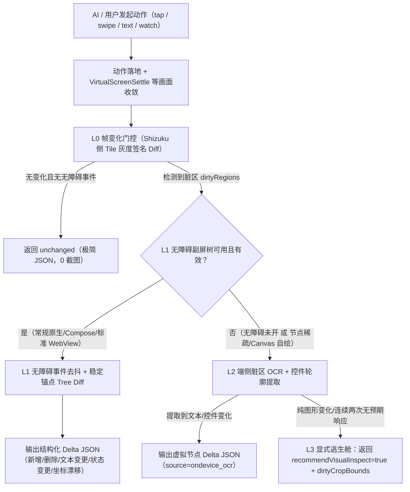

# 副屏无截图内容变动检测方案

> 本文档面向 `ShellVirtualScreen` + `VirtualScreenService` + `VirtualScreenTree` + `DeepSeekAccessibilityService` 链路，设计一套**以结构化增量与端侧轻量感知替代云端 VLM 截图识别**的副屏变动检测架构，解决连续操作延迟高、Token 成本大、旧帧误判与动态布局坐标漂移问题。

---

## 1. 问题背景与现状瓶颈

在当前的副屏 AI 交互模式中，模型主要依赖「发动作 → 等几秒 → 抓 PNG 截图 → 上传视觉模型识别 → 估算坐标 → 发下一步动作」的闭环。实机观察暴露出四类结构性瓶颈：

1. **高时延与旧帧误判**：PNG 截屏编码、管道传输、云端 VLM 推理叠加静止页面的 `frameAgeMs` 增长，常导致模型拿到动作前的旧帧并误判为“没点上”，随即重复补点引发事件堆积或 `VIRTUAL_SCREEN_BUSY`。
2. **动态布局导致坐标漂移**：例如答题页选中选项后该行高度变化、下方行整体下移；模型按旧截图的静态像素坐标去点下一行，极易落入空隙或错点相邻选项。
3. **视觉 Token 成本极高**：每一拍都上传整张 `RGBA_8888 → PNG` 全图，哪怕屏幕只变了一个勾选框、一条 Toast 或一个数字，也要消耗数千视觉 Token。
4. **高频截屏的附带系统开销**：反复触发整帧 CPU 回读（`copyPixelsFromBuffer` + `PNG compress`）与频繁工具调用会推高设备负载。

另一方面，本仓库已经具备关键基础设施：
- **Shizuku 侧**：[`ShellVirtualScreen.kt`](../../android/app/src/main/java/io/deepseekharness/mobile/virtualscreen/ShellVirtualScreen.kt) 持有副屏 `ImageReader`（最新 `Image` / `HardwareBuffer`）、`frameAt` 与 `VirtualScreenSettle` 稳定等待机制；
- **主进程无障碍侧**：[`VirtualScreenTree.kt`](../../android/app/src/main/java/io/deepseekharness/mobile/virtualscreen/VirtualScreenTree.kt) 与 [`DeepSeekAccessibilityService.kt`](../../android/app/src/main/java/io/deepseekharness/mobile/accessibility/DeepSeekAccessibilityService.kt) 已实现基于 `AccessibilityWindowInfo.getDisplayId()`（API 30+）的**副屏隔离节点树读取**、敏感窗口拦截与 `imeText` 读取。

缺失的核心拼图是：**一套事件驱动、分层降级的“变动感知与增量表达”引擎**，让端侧自己判断“变了没有、哪里变了、变成了什么语义”，只把极小的结构化 JSON Diff 返回给模型。

---

## 2. 业界成熟方案调研与借鉴

结合移动端 GUI Agent 与 Android 系统机制的公开实践，当前主流去截图化路线可分为四类，各自有明确边界：

| 方案路线 | 代表实践 / 系统机制 | 优势 | 局限与适用边界 |
| --- | --- | --- | --- |
| **无障碍树增量 Diff** | DroidRun、AndroidWorld、Mobile-Agent-E、Appium/UIAutomator2 语义树压缩 | 零视觉推理、毫秒级、直接给出准确可点 `bounds` 与 `checked/selected/text` 状态，天然免疫坐标漂移 | 依赖无障碍服务开启；Flutter（未开 Semantics）、游戏引擎、部分自绘 Canvas/WebView 树节点稀疏 |
| **无障碍事件驱动监听** | Android `AccessibilityEvent`（`TYPE_WINDOW_CONTENT_CHANGED`、`TYPE_WINDOW_STATE_CHANGED`、`TYPE_VIEW_SCROLLED`）+ `displayId` 过滤 | 系统推送而非盲目轮询，能精准捕获弹窗/Toast/局部状态变更，省电且低延迟 | 高频滚动/动画会产生事件风暴，必须做去抖（debounce）与窗口归属校验 |
| **端侧瓦片指纹 / 脏区检测** | 远程桌面（scrcpy/VNC 脏矩形）、Tile dHash / L1 灰度块差分 / SSIM | 不依赖无障碍、100% 覆盖 Canvas/游戏/WebView，单帧检测 < 2ms，可直接输出脏矩形区域 | 只能回答“是否变化、哪块区域变了”，本身不带文字语义 |
| **端侧离线 OCR + 轻量控件检测** | Google ML Kit Text Recognition v2、PP-OCRv4-mobile（ONNX/NCNN）、OmniParser 轻量检测头（LiteRT） | 只对脏区做端侧识别即可产出 `text + bounds` 虚拟节点，无需上传任何图片到云端模型 | 首次加载需 15–40MB 模型包与 ~40–120ms 端侧算力；对纯图形/无文字视觉题仍需回退 VLM |

**核心结论**：没有任何单一手段能覆盖 Android 100% 的应用形态，但把 **L0 瓦片脏区门控 + L1 无障碍事件与树 Diff + L2 端侧脏区 OCR 兜底** 串联起来，可以在 **90%+ 的常规交互步骤里彻底淘汰云端截图识别**，把 VLM 截图收敛为极少数非文本视觉场景的显式逃生舱（L3）。

---

## 3. 总体架构设计（四层分层感知）



### 3.1 L0：端侧瓦片脏区门控层（`ShellVirtualScreen` 侧）

**目标**：在不依赖无障碍、不触发 PNG 编码的前提下，在 **< 2ms** 内回答两个问题——① 屏幕到底有没有真正刷新变化；② 变化集中在哪个矩形区域。

**实现要点**：
1. **复用采集缓冲，不阻塞 60fps 预览**：
   - `collectFrame` 继续保持零 CPU 拷贝的快速路径（满足 `virtual-screen-preview-contract.test.mjs` 的零 `copyPixelsFromBuffer` 约束）；
   - 新增按需计算器 `VirtualScreenTileSignature`（纯 Kotlin，JVM 可单测）：仅在观察接口（`waitChange` / `action(returnDiff=true)`）被调用时，从 `latestImage` 按网格步长采样生成 **$8 \times 16$（128 块）低分辨率亮度均值 + 水平差分签名**（每块 2 字节，整屏签名仅 256 字节，复用固定 `IntArray` 缓冲，零每帧堆分配）。
2. **噪声过滤（防误触发）**：
   - 忽略顶部状态栏高度（如前 4% 高度）的时间/信号图标微变；
   - 对每个瓦片引入微小亮度容差阈值（如平均灰度差 $|\Delta L| \ge 6$ 且至少连续 1 块超出噪声底噪），滤除输入框光标闪烁或抗锯齿亚像素抖动；
   - 将相邻变化瓦片合并为 1–4 个外接脏矩形 `dirtyRegions: [{left, top, right, bottom}]` 与总变化占比 `changeRatio`。
3. **解决的核心痛点**：
   - 彻底取代“盲等 2–3 秒再截图”：一旦 `frameAt > inputAt` 且 L0 检测到有效脏区并收敛（`VirtualScreenSettle` 安静窗口结束），立刻结束等待；若一直无变化，如实返回 `changed: false` 与 `reason: "NO_VISUAL_OR_TREE_CHANGE"`，避免模型盲目补点。

### 3.2 L1：无障碍事件驱动 + 稳定锚点树增量 Diff 层（主进程主力层）

**目标**：对所有支持无障碍树的原生/Compose/标准 WebView 应用，用**几百字节的结构化增量 JSON**取代整屏截图，并显式报告控件状态变化与坐标漂移。

#### 3.2.1 严格的副屏事件隔离与去抖

在 `DeepSeekAccessibilityService` 中新增副屏变动观测器 `VirtualScreenChangeWatcher`：
- **仅监听副屏窗口**：在 `onAccessibilityEvent(event)` 中，通过 `event.source?.window?.displayId` 或 `getWindows()` 匹配 `activeVirtualDisplayId`（要求 `displayId > 0`，与 `VirtualScreenTree` 完全同一条安全边界，**绝不读取主屏 `displayId == 0`**）；
- **事件类型白名单**：`TYPE_WINDOW_STATE_CHANGED`、`TYPE_WINDOW_CONTENT_CHANGED`、`TYPE_VIEW_CLICKED`、`TYPE_VIEW_SELECTED`、`TYPE_VIEW_SCROLLED`、`TYPE_VIEW_TEXT_CHANGED`；
- **滑动去抖 + 最大等待**：收到事件后重置 `200ms` 定时器，同时设 `800ms` 硬上限（防止带倒计时/跑马灯的页面饿死观察者）；去抖触发后再做一次受控 `VirtualScreenTree.dump`（仍强制经过 `containsSensitiveWindow` 与 `isLockedOrScreenOff` 门禁）；
- **状态版本号**：每次生成新快照递增单调 `treeVersion: Long`，写入环状小缓存（保留最近 3 帧快照的精简模型，内存 < 128KB）。

#### 3.2.2 稳定节点键（Stable Node Key）与增量 Diff 算法

旧式按“索引”或按“坐标”做 diff 的致命缺陷是：当答题界面选中 B 项后 B 行增高，C、D 行的 `bounds.top` 整体下移，如果拿坐标当主键，Diff 会把 C、D 误报成“删除旧节点 + 新增新节点”。

因此采用**分层稳定锚点键**（`VirtualScreenTreeDiff`，纯 Kotlin 实现，100% JVM 可测）：
1. **节点过滤与归一化**：
   - 裁剪无语义布局容器（无 `text`、无 `desc`、无 `viewId` 且不可点击/不可滚动/不可编辑的纯容器直接折叠），将一屏 300+ 节点压缩到通常 20–60 个有效语义节点；
   - 对每个有效节点提取精简记录：`key`、`className`（短类名）、`viewId`、`text`、`desc`、`bounds [l, t, r, b]`、`center [cx, cy]`、`flags (clickable/checked/selected/enabled/focused/scrollable/editable)`。
2. **三段匹配策略**：
   - **第一优先级（强标识）**：同 `viewId` + 唯一出现（或同父路径下同序号）；
   - **第二优先级（语义锚点）**：同短类名 + 相同 `text` 或 `desc`（允许坐标平移，完美识别「选项 C 文本没变，只是整体下移了 48px」）；
   - **第三优先级（位置/结构近邻）**：同父容器下 IoU > 0.5 或中心距离最近（用于识别「按钮文字从“发送”变成了“发送中…”」）。
3. **变动归类与页面切换判定**：
   - **局部增量模式（`kind = "delta"`）**：输出 `added`、`removed`、`updated`（仅列出真正变化的字段：`textBefore → textAfter`、`checked: false → true`、`boundsShifted: { dy: +48, newCenter: [540, 968] }`）；
   - **整页切换模式（`kind = "page_changed"`）**：当 `packageName` / 窗口 ID 变化，或 `(added + removed) / max(prevCount, currCount) > 0.6` 时，直接输出压缩后的新页面语义节点列表（仍远小于截图 Token，且自带全部最新精确坐标）。

#### 3.2.3 根治坐标漂移的附加收益：动作按语义引用执行

有了稳定的 `nodeRef`（绑定 `treeVersion + stableKey`），模型下一步操作甚至不必手算像素坐标：
- 可直接发 `tap(nodeRef="v14#opt_C")` 或带最新 `center`；
- 端侧在执行点击前用 `stableKey` 在最新树里二次定位最新 `bounds` 中心点（若已漂移超过 4px 自动修正坐标并在回执里上报 `retargeted: true, deltaY: +48`）——彻底终结“按旧图坐标点到行缝或误点上一行”的问题！

### 3.3 L2：端侧脏区 OCR / 局部语义兜底层（无障碍盲区专用）

当遇到以下两类场景时自动降级到 L2：
- `VirtualScreenTree.available() == false`（用户未开启无障碍，或某款 ROM 的 `getWindows()` 拒绝暴露跨进程虚拟屏窗口）；
- L1 可读但节点严重稀疏（如 `interactiveNodeCount <= 3` 且 L0 检测到 `changeRatio >= 0.02`，典型是 Flutter Canvas、游戏、定制自绘控件或加密控件）。

**端侧低开销流水线（零图片上传）**：
1. **只切脏区**：根据 L0 产出的 `dirtyRegions`（各向外扩 16px 防止切半个字），从 `latestImage` 裁剪出小块 `Bitmap`（通常只占整屏 5%–25% 面积）；
2. **端侧离线文字识别**：
   - 方案 A（推荐优先）：**Google ML Kit Text Recognition v2 (Chinese + Latin)**（离线 bundled 模型，Apache 2.0，无需联网，骁龙中端机局部裁剪图推理约 25–60ms）；
   - 方案 B（完全不依赖 GMS 的开源替代）：**PP-OCRv4-mobile（det + rec int8）+ ONNX Runtime Mobile / NCNN**，同样离线运行在端侧，支持中英混排；
   - 懒加载策略：仅在真正触发 L2 时加载模型，空闲 60 秒自动卸载释放内存；
3. **行级文本 Diff**：
   - 维护一份 `OcrRegionCache`（按屏幕网格/行合并保存上一帧已知文本块）；
   - 只更新脏区内重识别出的文本块，与上一版比对后产出与 L1 同构的 `added / removed / updated` JSON（标记 `source: "ondevice_ocr"`，附带每行精确 `bounds` 与可点 `center`）。

### 3.4 L3：显式视觉逃生舱（按需裁剪截图）

以下场景天然属于视觉理解范畴，不强行用文字 Diff 替代：
- 图形验证码、图片题、地图标注、颜色/图标无文字状态指示；
- 模型连续执行两次操作后，L1 与 L2 均未回报预期语义变化。

此时端侧返回 `recommendVisualInspect: true` 与 `dirtyRegions`，模型可显式调用一次裁剪截图（仅回传脏区子图，仍比全屏省 60–80% 像素与 Token）。

---

## 4. 协议与工具面集成设计（对接本仓库现有代码）

### 4.1 动作内联回执（把 4 次往返压缩为 1 次）

在 `DeviceBridgeServer` 和 `dsh-mobile-shizuku` 插件中，为现有副屏动作（`tap`、`swipe`、`gesture`、`text`、`keyevent`、`back`）增加可选参数：
- `observeChange: boolean`（默认在连续操作模式下为 `true`）
- `settleMs: number`（沿用现有 `VirtualScreenSettle` 预算，如 `1200`）
- `observeMode: "auto" | "tree" | "tile" | "ocr"`（默认 `"auto"`：L1 → L0 → L2 自动选择）

动作落地并完成稳定收敛后，**在同一次工具返回中直接附带 `change` 摘要**，不再要求模型再发一次截图调用。

### 4.2 独立变动等待工具 `virtual_screen_wait_change`

用于等待加载页、倒计时、异步弹窗或后台刷新：
- 入参：`{ sessionId, sinceVersion, timeoutMs = 5000, settleMs = 300, mode = "auto" }`
- 行为：订阅 `VirtualScreenChangeWatcher` + L0 帧序列号；事件到达并稳定后立刻唤醒返回，超时则诚实返回 `changed: false`。

### 4.3 精简 JSON Delta 契约示例

一次典型的答题点击（点击第 10 题选项 B，导致 B 行展开、C/D 下移）返回体仅约 **180 tokens**（同等 PNG 截图通常 1500–4000 tokens）：

```json
{
  "ok": true,
  "sessionId": "6f2a...",
  "displayId": 7,
  "observe": {
    "source": "accessibility_diff",
    "version": 15,
    "baseVersion": 14,
    "kind": "delta",
    "changed": true,
    "elapsedMs": 142,
    "dirtyRegions": [{ "l": 36, "t": 620, "r": 1044, "b": 1120 }],
    "updated": [
      {
        "ref": "v15#opt_B",
        "text": "B. 应当在十五日内书面告知",
        "changes": { "checked": [false, true], "height": [84, 128] },
        "center": [540, 704]
      },
      {
        "ref": "v15#opt_C",
        "text": "C. 可以口头通知当事人",
        "changes": { "dy": 44 },
        "center": [540, 842]
      },
      {
        "ref": "v15#opt_D",
        "text": "D. 无需另行告知",
        "changes": { "dy": 44 },
        "center": [540, 964]
      }
    ],
    "added": [
      { "ref": "v15#hint_selected", "text": "已选择 B", "center": [180, 746] }
    ],
    "removed": [],
    "recommendVisualInspect": false
  }
}
```

模型一眼就能看到：
1. 点击确实生效（`opt_B` 的 `checked` 从 `false → true`，耗时 `142ms`）；
2. `opt_C` 与 `opt_D` 因布局展开下移了 `44px`，下一拍的准确中心坐标已更新为 `[540, 842]` 与 `[540, 964]`；
3. 全程 **0 次截屏、0 次图片上传**。

---

## 5. 与本仓库安全边界及性能预算的对齐

| 约束维度 | 必须守住的现有红线 | 本方案的对应保障 |
| --- | --- | --- |
| **显示隔离** | 严禁读取主屏（`displayId == 0`）或绕过主屏白名单（见 `VirtualScreenTree.kt` 注释） | `VirtualScreenChangeWatcher` 只接收 `displayId == activeVirtualDisplayId && displayId > 0` 的事件与窗口；副屏关闭瞬间立即摘除监听 |
| **敏感内容拦截** | 密码框、验证码、支付、权限弹窗整屏拒绝（`containsSensitiveWindow`）与锁屏拒绝 | L1 每次 diff 前必过 `VirtualScreenTree.blockReason`；命中敏感窗口时 L0/L2 同步静默，绝不通过 OCR 绕过敏感拦截 |
| **预览帧率与锁分离** | `ShellVirtualScreen.frame(sessionId)` 无实例锁阻塞、`collectFrame` 零 CPU 拷贝（`virtual-screen-preview-contract.test.mjs`） | L0 瓦片签名不在 `collectFrame` 中执行，仅在按需观察调用时短持 `frameLock` 读取降采样亮度数组，锁外计算脏矩形 |
| **SystemUI 通知安全** | 避免高频工具调用触发常驻通知重发风暴 | 内联变动回执把多次工具调用合并为 1 次，且变动检测在原生侧纯内存完成，不触碰任何通知更新路径 |
| **隐私与日志边界** | 诊断日志不记录屏幕文本或用户内容 | 诊断仅记录 `observe_source`、`elapsed_ms`、`node_count`、`dirty_ratio`、`changed` 计数，绝不落盘文本或 OCR 内容 |

---

## 6. 分阶段实施路线图与验收指标

### 阶段规划（Phase 1 & Phase 2 零 OCR 闭环已落地）

1. **Phase 1（已落地，纯 Kotlin + 零新依赖 + 零 OCR）：深层语义树 + 直接控件动作 + 动作内联 Tree Diff + AI 主动一步启动**
   - 已新增 [`VirtualScreenTreeDiff.kt`](../../android/app/src/main/java/io/deepseekharness/mobile/virtualscreen/VirtualScreenTreeDiff.kt) 与 [`VirtualScreenTreeDiffTest.kt`](../../android/app/src/test/java/io/deepseekharness/mobile/virtualscreen/VirtualScreenTreeDiffTest.kt)：支持 24 层深层容器折叠（`mobile_virtual_screen_tree(compact=true)`）与非坐标主键的前后结构 Diff（自动输出 `checked/selected/text` 变更、兄弟节点 `dy` 坐标漂移与整页切换后的新页 `elements`）；
   - 已在 [`DeepSeekAccessibilityService.kt`](../../android/app/src/main/java/io/deepseekharness/mobile/accessibility/DeepSeekAccessibilityService.kt) 与 [`VirtualScreenTree.kt`](../../android/app/src/main/java/io/deepseekharness/mobile/virtualscreen/VirtualScreenTree.kt) 新增副屏隔离的 `performNodeActionOnDisplay`（`node_click` / `node_long_click` / `node_scroll`），优先无障碍原生动作、拒绝时自动以**此刻实时 bounds 中心**回退点击；
   - 已在 [`VirtualScreenService.kt`](../../android/app/src/main/java/io/deepseekharness/mobile/virtualscreen/VirtualScreenService.kt) 为所有交互动作默认内联返回 `observe` 变更摘要；
   - 已升级 [`VirtualScreenAgentStarter.kt`](../../android/app/src/main/java/io/deepseekharness/mobile/virtualscreen/VirtualScreenAgentStarter.kt) 与插件 `mobile_virtual_screen_start`：AI 主动打开副屏时默认同步等待就绪（最多 8s），直接返回 `sessionId`、`displayId`、`treeSupported` 及首屏语义控件，并支持 `switchIfActive` 与 `showOverlay`。

2. **Phase 2（已落地，零新依赖 + 零 OCR）：L0 瓦片脏区门控**
   - 已新增 [`VirtualScreenTileDiff.kt`](../../android/app/src/main/java/io/deepseekharness/mobile/virtualscreen/VirtualScreenTileDiff.kt) 与 [`VirtualScreenTileDiffTest.kt`](../../android/app/src/test/java/io/deepseekharness/mobile/virtualscreen/VirtualScreenTileDiffTest.kt)，接入 [`ShellVirtualScreen.kt`](../../android/app/src/main/java/io/deepseekharness/mobile/virtualscreen/ShellVirtualScreen.kt) 动作前后按需采样（仅读 512 像素，零 Bitmap 拷贝、零 PNG 编码），在无障碍未开或无节点树时自动作为 `observe`（`source="tile_diff"`）返回变化占比与像素级 `dirtyRegions`。

3. **Phase 3（可选增强，非必需）：无障碍事件订阅与极少数纯图形逃生舱**
   - 常规交互已完全不依赖 OCR；后续仅按需补充 `AccessibilityEvent` 主动推送长等待，以及极少数纯图片题/图形验证码场景的脏区裁剪截图逃生舱。

### 量化验收指标

| 指标 | 当前纯截图基线（实测参考） | Phase 1 达标线 | Phase 2–3 达标线 |
| --- | --- | --- | --- |
| 常规操作截图调用占比 | ~100% | ≤ 20% | ≤ 5%（仅纯图形/L3 场景） |
| 单步“动作 → 确认变动”端到端时延 | 2,000–7,100 ms（含盲等与 VLM） | ≤ 450 ms（L1 事件 + Diff） | ≤ 600 ms（L2 脏区 OCR） |
| 单步观测 Token 消耗 | ~1,500–4,000 tokens / 步 | ~150–400 tokens / 步 | ~200–500 tokens / 步 |
| 动态布局展开导致的点击漂移失误率 | ~8–9%（实测答题页） | ≤ 1%（稳定锚点重定位） | ≤ 2% |
| L0 瓦片计算对 60fps 预览帧率影响 | — | 0（未启用） | < 1 FPS 波动，不阻塞 `frame()` |
